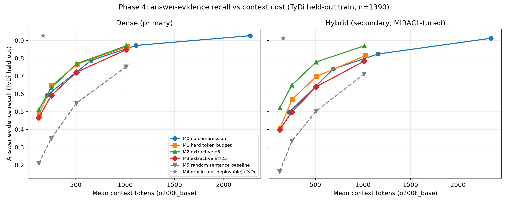

# Phase 3 finalization and Phase 4 context compression

## Phase 3 freeze

- Tag `phase3-complete` -> commit `1c37a3c348f09016005388e246049690ffe22aae` (`phase 3: dense/hybrid retrieval, significance, and reports`).
- Working tree changes preserved: 68.
- Phase 3 result checksums: `results/phase3_freeze_manifest.json`.

## Phase 3 final MRR@100 (metric-only recomputation)

Every ranking is capped at 100 candidates before MRR is computed. Rankings were replayed from frozen Phase 3 artifacts; the replay matched all Phase 3 top-20 records exactly. No embeddings were recomputed and no retriever was reconfigured.

| dataset | system | n | MRR@100 | 95% CI |
|---|---|---:|---:|---|
| miracl_dev | BM25 | 411 | 0.5111 | [0.4701, 0.5527] |
| miracl_dev | Dense (e5-small) | 411 | 0.5232 | [0.4920, 0.5552] |
| miracl_dev | Hybrid (RRF) | 411 | 0.5914 | [0.5549, 0.6277] |
| tydi_validation | BM25 | 113 | 0.3204 | [0.2542, 0.3888] |
| tydi_validation | Dense (e5-small) | 113 | 0.6580 | [0.5880, 0.7262] |
| tydi_validation | Hybrid (RRF) | 113 | 0.4937 | [0.4295, 0.5583] |

## TyDi-train-tuned hybrid sensitivity (separate experiment)

This is **not** the primary hybrid. The main hybrid remains the MIRACL-train-tuned setting. See `results/phase3_tydi_hybrid_sensitivity.md` for the full table.

| setting | w_BM25 | w_dense | R@10 | MRR@100 | nDCG@10 |
|---|---:|---:|---:|---:|---:|
| TyDi-train-tuned hybrid sensitivity | 0.00 | 1.00 | 0.8938 | 0.6580 | 0.7139 |

## Phase 4 scope and integrity

- Dense is the primary Phase 4 retriever; Hybrid is secondary and always uses the main MIRACL-train-tuned RRF configuration.
- All methods use exactly the same top-10 parent passages per query and retriever.
- The custom Bengali QA review dataset was not read, filtered, overwritten, or mixed into these benchmarks. Manual `keep`/`reject`/`fix` decisions were preserved.
- No external API was called and no new model was introduced. The only embedding model is the existing `intfloat/multilingual-e5-small`.
- TyDi split seed 42: 1000 tuning questions and 1390 held-out training questions. Method parameters are fixed, so no fitting was performed; evaluation uses the held-out split and validation.
- MIRACL reports only gold-passage retention and token counts; no answer recall or answer-correctness claim is made.

## Token counting

- Budget enforcement: `o200k_base` (tiktoken 0.14.0); special tokens excluded.
- Comparison tokenizer: `intfloat/multilingual-e5-small tokenizer` (transformers 5.22.2); special tokens included, no `passage: ` prefix. Empty context counts as 0.
- M1 truncates the concatenated string at the token budget, decoding the retained token IDs and trimming until re-encoding is <= budget. M2/M3/M5 include a sentence only if it fits the remaining budget; a single sentence longer than the whole budget is truncated to the budget as a documented fallback.

## Primary results: TyDi held-out (dense, primary retriever)

| method | setting | o200k tokens | e5 tokens | answer recall | gold retention | evidence loss |
|---|---:|---:|---:|---:|---:|---:|
| M0 no compression | top1 | 210.0 [202.1, 218.3] | 191.1 [183.9, 198.8] | 0.5921 [0.5662, 0.6180] | 0.3802 [0.3529, 0.4084] | 0.3610 [0.3346, 0.3866] |
| M0 no compression | top3 | 653.6 [635.5, 672.0] | 593.8 [577.1, 610.9] | 0.7871 [0.7655, 0.8086] | 0.7528 [0.7280, 0.7775] | 0.1506 [0.1312, 0.1700] |
| M0 no compression | top5 | 1111.8 [1086.7, 1137.4] | 1010.8 [987.6, 1034.6] | 0.8719 [0.8540, 0.8892] | 0.8849 [0.8662, 0.9028] | 0.0590 [0.0466, 0.0722] |
| M0 no compression | top10 | 2268.1 [2227.9, 2307.7] | 2065.0 [2027.3, 2102.4] | 0.9266 [0.9129, 0.9403] | 1.0000 [1.0000, 1.0000] | 0.0000 [0.0000, 0.0000] |
| M1 hard token budget | B128 | 128.0 [128.0, 128.0] | 116.6 [116.1, 117.1] | 0.4871 [0.4612, 0.5129] | 0.4552 [0.4271, 0.4842] | 0.4744 [0.4472, 0.5016] |
| M1 hard token budget | B256 | 256.0 [256.0, 256.0] | 232.1 [231.2, 233.0] | 0.6460 [0.6209, 0.6712] | 0.6172 [0.5899, 0.6454] | 0.3028 [0.2772, 0.3284] |
| M1 hard token budget | B512 | 512.0 [512.0, 512.0] | 463.9 [462.3, 465.5] | 0.7662 [0.7439, 0.7885] | 0.7553 [0.7306, 0.7801] | 0.1731 [0.1522, 0.1933] |
| M1 hard token budget | B1024 | 1020.3 [1018.4, 1021.9] | 926.3 [923.0, 929.5] | 0.8655 [0.8468, 0.8835] | 0.9020 [0.8849, 0.9190] | 0.0660 [0.0528, 0.0800] |
| M2 extractive e5 | B128 | 125.0 [124.8, 125.2] | 112.1 [111.6, 112.7] | 0.5115 [0.4849, 0.5381] | 0.6300 [0.6027, 0.6581] | 0.4480 [0.4208, 0.4759] |
| M2 extractive e5 | B256 | 252.7 [252.4, 252.9] | 225.9 [224.9, 226.9] | 0.6345 [0.6086, 0.6597] | 0.8107 [0.7877, 0.8329] | 0.3152 [0.2896, 0.3408] |
| M2 extractive e5 | B512 | 507.4 [507.1, 507.6] | 455.4 [453.6, 457.1] | 0.7691 [0.7468, 0.7906] | 0.9497 [0.9369, 0.9616] | 0.1700 [0.1491, 0.1918] |
| M2 extractive e5 | B1024 | 1011.6 [1009.8, 1013.2] | 912.3 [908.8, 915.7] | 0.8698 [0.8518, 0.8871] | 0.9991 [0.9974, 1.0000] | 0.0613 [0.0481, 0.0753] |
| M3 extractive BM25 | B128 | 124.8 [124.6, 125.0] | 113.1 [112.5, 113.7] | 0.4662 [0.4403, 0.4921] | 0.5976 [0.5695, 0.6257] | 0.4969 [0.4697, 0.5241] |
| M3 extractive BM25 | B256 | 251.9 [251.7, 252.2] | 227.1 [226.2, 228.1] | 0.5906 [0.5640, 0.6165] | 0.7775 [0.7536, 0.8014] | 0.3626 [0.3369, 0.3890] |
| M3 extractive BM25 | B512 | 506.0 [505.6, 506.3] | 456.4 [454.7, 458.1] | 0.7209 [0.6971, 0.7439] | 0.9156 [0.8994, 0.9318] | 0.2220 [0.1995, 0.2446] |
| M3 extractive BM25 | B1024 | 1009.6 [1007.8, 1011.2] | 913.5 [910.1, 916.7] | 0.8475 [0.8281, 0.8662] | 0.9864 [0.9795, 0.9923] | 0.0854 [0.0707, 0.1017] |
| M4 oracle (not deployable) | oracle | 167.5 [157.3, 178.0] | 151.8 [142.5, 161.1] | 0.9259 [0.9115, 0.9396] | 0.9991 [0.9974, 1.0000] | 0.0008 [0.0000, 0.0023] |
| M5 random sentence baseline | B128 | 124.3 [124.1, 124.6] | 113.7 [113.1, 114.2] | 0.2094 [0.1878, 0.2309] | 0.4714 [0.4425, 0.4996] | 0.7741 [0.7508, 0.7974] |
| M5 random sentence baseline | B256 | 251.6 [251.3, 251.8] | 228.7 [227.9, 229.5] | 0.3496 [0.3259, 0.3755] | 0.6249 [0.5976, 0.6522] | 0.6227 [0.5955, 0.6491] |
| M5 random sentence baseline | B512 | 505.5 [505.2, 505.7] | 458.8 [457.4, 460.1] | 0.5475 [0.5209, 0.5741] | 0.8269 [0.8048, 0.8483] | 0.4092 [0.3827, 0.4363] |
| M5 random sentence baseline | B1024 | 1008.5 [1006.6, 1010.1] | 916.7 [913.5, 919.6] | 0.7511 [0.7281, 0.7734] | 0.9668 [0.9565, 0.9761] | 0.1894 [0.1677, 0.2112] |

## Secondary results: TyDi held-out (hybrid, MIRACL-tuned)

| method | setting | o200k tokens | e5 tokens | answer recall | gold retention | evidence loss |
|---|---:|---:|---:|---:|---:|---:|
| M0 no compression | top1 | 225.0 [215.5, 235.1] | 205.6 [196.9, 214.9] | 0.4964 [0.4698, 0.5230] | 0.1573 [0.1356, 0.1790] | 0.4558 [0.4282, 0.4834] |
| M0 no compression | top3 | 688.9 [670.0, 709.1] | 627.4 [609.7, 646.5] | 0.7396 [0.7165, 0.7626] | 0.6338 [0.6049, 0.6609] | 0.1893 [0.1680, 0.2114] |
| M0 no compression | top5 | 1158.6 [1133.5, 1184.8] | 1053.8 [1030.3, 1078.5] | 0.8237 [0.8036, 0.8439] | 0.8228 [0.7993, 0.8454] | 0.0970 [0.0812, 0.1144] |
| M0 no compression | top10 | 2348.0 [2307.4, 2390.1] | 2137.0 [2098.4, 2177.3] | 0.9122 [0.8971, 0.9266] | 1.0000 [1.0000, 1.0000] | 0.0000 [0.0000, 0.0000] |
| M1 hard token budget | B128 | 128.0 [128.0, 128.0] | 117.3 [116.8, 117.8] | 0.4079 [0.3820, 0.4338] | 0.2324 [0.2071, 0.2577] | 0.5528 [0.5260, 0.5797] |
| M1 hard token budget | B256 | 256.0 [256.0, 256.0] | 233.1 [232.3, 234.0] | 0.5698 [0.5439, 0.5957] | 0.4186 [0.3888, 0.4476] | 0.3754 [0.3486, 0.4022] |
| M1 hard token budget | B512 | 512.0 [512.0, 512.0] | 465.3 [463.8, 466.9] | 0.6978 [0.6734, 0.7216] | 0.6239 [0.5949, 0.6519] | 0.2350 [0.2121, 0.2587] |
| M1 hard token budget | B1024 | 1023.1 [1022.3, 1023.8] | 929.4 [926.4, 932.2] | 0.8144 [0.7942, 0.8338] | 0.8291 [0.8065, 0.8508] | 0.1073 [0.0907, 0.1246] |
| M2 extractive e5 | B128 | 125.0 [124.8, 125.2] | 112.5 [111.9, 113.1] | 0.5209 [0.4942, 0.5468] | 0.6465 [0.6175, 0.6745] | 0.4290 [0.4022, 0.4558] |
| M2 extractive e5 | B256 | 252.6 [252.3, 252.8] | 226.5 [225.5, 227.5] | 0.6489 [0.6237, 0.6734] | 0.8535 [0.8318, 0.8743] | 0.2886 [0.2642, 0.3131] |
| M2 extractive e5 | B512 | 506.6 [506.3, 506.9] | 455.2 [453.5, 457.0] | 0.7784 [0.7568, 0.8000] | 0.9638 [0.9530, 0.9747] | 0.1467 [0.1270, 0.1656] |
| M2 extractive e5 | B1024 | 1013.8 [1012.9, 1014.6] | 914.8 [911.5, 917.9] | 0.8698 [0.8518, 0.8871] | 0.9982 [0.9955, 1.0000] | 0.0465 [0.0355, 0.0584] |
| M3 extractive BM25 | B128 | 124.9 [124.7, 125.0] | 113.0 [112.5, 113.6] | 0.3986 [0.3734, 0.4237] | 0.4964 [0.4675, 0.5262] | 0.5631 [0.5355, 0.5907] |
| M3 extractive BM25 | B256 | 252.2 [252.0, 252.4] | 227.3 [226.3, 228.2] | 0.4971 [0.4712, 0.5237] | 0.6401 [0.6112, 0.6682] | 0.4550 [0.4274, 0.4819] |
| M3 extractive BM25 | B512 | 506.2 [505.9, 506.5] | 456.4 [454.8, 458.1] | 0.6388 [0.6137, 0.6640] | 0.8418 [0.8201, 0.8626] | 0.2997 [0.2744, 0.3249] |
| M3 extractive BM25 | B1024 | 1012.8 [1011.9, 1013.5] | 915.8 [912.6, 918.8] | 0.7835 [0.7619, 0.8043] | 0.9810 [0.9729, 0.9882] | 0.1412 [0.1222, 0.1601] |
| M4 oracle (not deployable) | oracle | 159.9 [150.5, 169.5] | 145.1 [136.6, 153.7] | 0.9115 [0.8964, 0.9259] | 0.9991 [0.9973, 1.0000] | 0.0008 [0.0000, 0.0024] |
| M5 random sentence baseline | B128 | 124.3 [124.1, 124.6] | 113.5 [113.0, 114.0] | 0.1633 [0.1439, 0.1820] | 0.4647 [0.4358, 0.4946] | 0.8210 [0.7997, 0.8415] |
| M5 random sentence baseline | B256 | 251.4 [251.1, 251.6] | 228.5 [227.7, 229.3] | 0.3338 [0.3094, 0.3583] | 0.6329 [0.6049, 0.6609] | 0.6341 [0.6073, 0.6609] |
| M5 random sentence baseline | B512 | 505.3 [505.1, 505.6] | 458.9 [457.5, 460.3] | 0.5014 [0.4748, 0.5281] | 0.8165 [0.7939, 0.8391] | 0.4503 [0.4227, 0.4779] |
| M5 random sentence baseline | B1024 | 1011.1 [1010.2, 1011.8] | 918.3 [915.5, 920.9] | 0.7108 [0.6871, 0.7338] | 0.9539 [0.9412, 0.9656] | 0.2208 [0.1987, 0.2437] |

## TyDi validation (dense and hybrid)

### Dense

| method | setting | o200k tokens | e5 tokens | answer recall | gold retention | evidence loss |
|---|---:|---:|---:|---:|---:|---:|
| M0 no compression | top1 | 208.4 [188.8, 229.6] | 192.6 [173.4, 214.0] | 0.7257 [0.6460, 0.8053] | 0.5743 [0.4752, 0.6733] | 0.2336 [0.1589, 0.3178] |
| M0 no compression | top3 | 694.0 [632.3, 762.6] | 637.3 [579.6, 701.0] | 0.9027 [0.8496, 0.9558] | 0.8713 [0.8020, 0.9307] | 0.0467 [0.0093, 0.0935] |
| M0 no compression | top5 | 1168.5 [1074.0, 1271.4] | 1070.9 [981.4, 1168.7] | 0.9292 [0.8761, 0.9735] | 0.9307 [0.8812, 0.9802] | 0.0187 [0.0000, 0.0467] |
| M0 no compression | top10 | 2414.6 [2259.7, 2575.6] | 2212.8 [2063.3, 2366.8] | 0.9469 [0.9027, 0.9823] | 1.0000 [1.0000, 1.0000] | 0.0000 [0.0000, 0.0000] |
| M1 hard token budget | B128 | 128.0 [128.0, 128.0] | 116.8 [115.1, 118.6] | 0.6195 [0.5310, 0.7080] | 0.6634 [0.5644, 0.7525] | 0.3458 [0.2617, 0.4393] |
| M1 hard token budget | B256 | 256.0 [256.0, 256.0] | 234.1 [230.9, 237.2] | 0.7699 [0.6903, 0.8407] | 0.7723 [0.6832, 0.8515] | 0.1869 [0.1121, 0.2617] |
| M1 hard token budget | B512 | 512.0 [512.0, 512.0] | 468.5 [462.9, 474.0] | 0.8496 [0.7788, 0.9115] | 0.8713 [0.8020, 0.9307] | 0.1028 [0.0467, 0.1591] |
| M1 hard token budget | B1024 | 1021.8 [1018.7, 1024.0] | 929.7 [919.6, 940.1] | 0.9204 [0.8673, 0.9646] | 0.9505 [0.9010, 0.9901] | 0.0280 [0.0000, 0.0654] |
| M2 extractive e5 | B128 | 125.5 [125.0, 126.0] | 113.0 [110.7, 115.2] | 0.4956 [0.4071, 0.5841] | 0.7426 [0.6535, 0.8218] | 0.4766 [0.3832, 0.5701] |
| M2 extractive e5 | B256 | 252.9 [252.4, 253.4] | 227.5 [223.8, 231.2] | 0.6195 [0.5310, 0.7080] | 0.8911 [0.8317, 0.9505] | 0.3458 [0.2523, 0.4393] |
| M2 extractive e5 | B512 | 507.0 [505.4, 508.2] | 457.9 [451.2, 464.5] | 0.7257 [0.6372, 0.8053] | 0.9901 [0.9703, 1.0000] | 0.2336 [0.1589, 0.3178] |
| M2 extractive e5 | B1024 | 1013.1 [1010.0, 1015.5] | 917.8 [906.3, 929.2] | 0.8584 [0.7876, 0.9204] | 0.9901 [0.9703, 1.0000] | 0.0935 [0.0467, 0.1495] |
| M3 extractive BM25 | B128 | 124.7 [124.2, 125.3] | 111.8 [109.7, 113.9] | 0.4159 [0.3274, 0.5044] | 0.6733 [0.5842, 0.7624] | 0.5607 [0.4673, 0.6542] |
| M3 extractive BM25 | B256 | 252.3 [251.6, 252.9] | 226.5 [223.3, 229.7] | 0.5398 [0.4513, 0.6283] | 0.7822 [0.7030, 0.8614] | 0.4299 [0.3364, 0.5234] |
| M3 extractive BM25 | B512 | 506.2 [505.4, 506.9] | 458.0 [452.1, 463.9] | 0.6814 [0.5929, 0.7699] | 0.9406 [0.8911, 0.9802] | 0.2804 [0.1963, 0.3645] |
| M3 extractive BM25 | B1024 | 1011.6 [1008.6, 1013.9] | 920.3 [909.7, 930.9] | 0.8584 [0.7876, 0.9204] | 1.0000 [1.0000, 1.0000] | 0.0935 [0.0467, 0.1495] |
| M4 oracle (not deployable) | oracle | 133.5 [108.4, 161.7] | 125.0 [101.3, 151.9] | 0.9469 [0.9027, 0.9823] | 1.0000 [1.0000, 1.0000] | 0.0000 [0.0000, 0.0000] |
| M5 random sentence baseline | B128 | 124.4 [123.5, 125.1] | 113.5 [111.7, 115.3] | 0.1770 [0.1062, 0.2478] | 0.4653 [0.3663, 0.5644] | 0.8131 [0.7383, 0.8879] |
| M5 random sentence baseline | B256 | 251.8 [250.6, 252.7] | 228.4 [225.5, 231.2] | 0.3451 [0.2566, 0.4336] | 0.6436 [0.5545, 0.7327] | 0.6355 [0.5421, 0.7290] |
| M5 random sentence baseline | B512 | 506.4 [505.7, 507.0] | 459.1 [454.2, 463.9] | 0.5310 [0.4425, 0.6195] | 0.8812 [0.8119, 0.9406] | 0.4393 [0.3458, 0.5327] |
| M5 random sentence baseline | B1024 | 1010.5 [1007.5, 1012.7] | 920.6 [911.1, 930.2] | 0.6549 [0.5664, 0.7434] | 0.9604 [0.9208, 0.9901] | 0.3084 [0.2243, 0.4019] |

### Hybrid (main MIRACL-tuned configuration)

| method | setting | o200k tokens | e5 tokens | answer recall | gold retention | evidence loss |
|---|---:|---:|---:|---:|---:|---:|
| M0 no compression | top1 | 222.9 [198.6, 250.4] | 205.6 [183.2, 231.2] | 0.5487 [0.4602, 0.6372] | 0.3100 [0.2200, 0.4000] | 0.4206 [0.3271, 0.5140] |
| M0 no compression | top3 | 691.2 [635.1, 752.3] | 634.6 [580.8, 693.0] | 0.7876 [0.7080, 0.8584] | 0.7200 [0.6300, 0.8100] | 0.1682 [0.1028, 0.2430] |
| M0 no compression | top5 | 1174.9 [1083.3, 1274.1] | 1074.2 [986.9, 1169.5] | 0.8938 [0.8319, 0.9469] | 0.9000 [0.8400, 0.9600] | 0.0561 [0.0187, 0.1028] |
| M0 no compression | top10 | 2379.6 [2238.0, 2529.7] | 2171.7 [2034.3, 2316.8] | 0.9469 [0.9027, 0.9823] | 1.0000 [1.0000, 1.0000] | 0.0000 [0.0000, 0.0000] |
| M1 hard token budget | B128 | 128.0 [128.0, 128.0] | 117.0 [115.3, 118.7] | 0.4336 [0.3451, 0.5221] | 0.3900 [0.2900, 0.4900] | 0.5421 [0.4486, 0.6355] |
| M1 hard token budget | B256 | 256.0 [256.0, 256.0] | 233.7 [230.7, 236.7] | 0.6106 [0.5221, 0.6991] | 0.5300 [0.4300, 0.6300] | 0.3551 [0.2617, 0.4486] |
| M1 hard token budget | B512 | 512.0 [512.0, 512.0] | 465.7 [459.8, 471.3] | 0.7522 [0.6726, 0.8319] | 0.7300 [0.6400, 0.8200] | 0.2056 [0.1308, 0.2804] |
| M1 hard token budget | B1024 | 1022.4 [1019.2, 1024.0] | 929.6 [918.6, 940.3] | 0.8584 [0.7876, 0.9204] | 0.8900 [0.8300, 0.9500] | 0.0935 [0.0467, 0.1495] |
| M2 extractive e5 | B128 | 124.9 [124.2, 125.7] | 112.0 [109.7, 114.2] | 0.5044 [0.4159, 0.5929] | 0.7100 [0.6200, 0.8000] | 0.4673 [0.3738, 0.5607] |
| M2 extractive e5 | B256 | 251.7 [250.6, 252.6] | 226.5 [222.9, 230.1] | 0.6106 [0.5221, 0.6991] | 0.9000 [0.8400, 0.9500] | 0.3551 [0.2710, 0.4486] |
| M2 extractive e5 | B512 | 507.3 [506.4, 508.0] | 457.8 [450.9, 464.5] | 0.7611 [0.6814, 0.8407] | 0.9800 [0.9500, 1.0000] | 0.1963 [0.1215, 0.2710] |
| M2 extractive e5 | B1024 | 1013.1 [1009.4, 1015.4] | 915.7 [903.4, 927.6] | 0.8761 [0.8142, 0.9381] | 1.0000 [1.0000, 1.0000] | 0.0748 [0.0280, 0.1308] |
| M3 extractive BM25 | B128 | 124.6 [123.4, 125.5] | 112.5 [110.2, 114.7] | 0.3274 [0.2389, 0.4159] | 0.5800 [0.4800, 0.6800] | 0.6542 [0.5607, 0.7383] |
| M3 extractive BM25 | B256 | 251.6 [250.7, 252.4] | 226.0 [222.1, 229.7] | 0.4336 [0.3451, 0.5221] | 0.7000 [0.6100, 0.7900] | 0.5421 [0.4486, 0.6355] |
| M3 extractive BM25 | B512 | 506.6 [506.0, 507.3] | 456.9 [450.4, 463.2] | 0.5664 [0.4690, 0.6549] | 0.8800 [0.8100, 0.9400] | 0.4019 [0.3084, 0.4953] |
| M3 extractive BM25 | B1024 | 1012.0 [1008.4, 1014.3] | 918.3 [906.8, 929.5] | 0.7699 [0.6903, 0.8407] | 0.9700 [0.9300, 1.0000] | 0.1869 [0.1121, 0.2617] |
| M4 oracle (not deployable) | oracle | 131.6 [106.9, 159.2] | 122.6 [99.0, 150.0] | 0.9469 [0.9027, 0.9823] | 1.0000 [1.0000, 1.0000] | 0.0000 [0.0000, 0.0000] |
| M5 random sentence baseline | B128 | 124.3 [123.6, 125.0] | 113.9 [112.3, 115.5] | 0.1858 [0.1150, 0.2566] | 0.5800 [0.4800, 0.6800] | 0.8037 [0.7290, 0.8785] |
| M5 random sentence baseline | B256 | 251.4 [250.5, 252.1] | 227.5 [224.6, 230.4] | 0.3540 [0.2655, 0.4425] | 0.7100 [0.6200, 0.8000] | 0.6262 [0.5327, 0.7196] |
| M5 random sentence baseline | B512 | 505.1 [504.3, 505.8] | 459.8 [455.1, 464.5] | 0.4248 [0.3363, 0.5133] | 0.8600 [0.7900, 0.9200] | 0.5514 [0.4579, 0.6449] |
| M5 random sentence baseline | B1024 | 1011.1 [1007.6, 1013.3] | 918.2 [907.9, 928.4] | 0.6903 [0.6018, 0.7699] | 0.9700 [0.9300, 1.0000] | 0.2710 [0.1869, 0.3551] |

## MIRACL dev (retention and tokens only)

### Dense

| method | setting | o200k tokens | e5 tokens | answer recall | gold retention | evidence loss |
|---|---:|---:|---:|---:|---:|---:|
| M0 no compression | top1 | 214.4 [198.1, 234.0] | 195.3 [180.1, 213.5] | n/a | 0.2963 [0.2513, 0.3439] | n/a |
| M0 no compression | top3 | 667.0 [634.7, 702.7] | 606.1 [576.0, 639.4] | n/a | 0.8095 [0.7698, 0.8492] | n/a |
| M0 no compression | top5 | 1118.4 [1073.1, 1169.0] | 1017.3 [975.0, 1064.1] | n/a | 0.9127 [0.8836, 0.9392] | n/a |
| M0 no compression | top10 | 2287.1 [2211.3, 2367.2] | 2084.9 [2013.6, 2159.3] | n/a | 1.0000 [1.0000, 1.0000] | n/a |
| M1 hard token budget | B128 | 128.0 [128.0, 128.0] | 116.9 [116.0, 117.8] | n/a | 0.3730 [0.3254, 0.4233] | n/a |
| M1 hard token budget | B256 | 256.0 [256.0, 256.0] | 232.6 [231.1, 234.2] | n/a | 0.5820 [0.5317, 0.6323] | n/a |
| M1 hard token budget | B512 | 512.0 [512.0, 512.0] | 464.6 [461.8, 467.4] | n/a | 0.7884 [0.7460, 0.8280] | n/a |
| M1 hard token budget | B1024 | 1022.0 [1020.0, 1023.6] | 929.0 [923.6, 934.1] | n/a | 0.9153 [0.8862, 0.9418] | n/a |
| M2 extractive e5 | B128 | 125.2 [124.8, 125.5] | 113.5 [112.5, 114.5] | n/a | 0.7381 [0.6931, 0.7804] | n/a |
| M2 extractive e5 | B256 | 252.7 [252.2, 253.1] | 227.6 [225.8, 229.3] | n/a | 0.8836 [0.8492, 0.9153] | n/a |
| M2 extractive e5 | B512 | 507.4 [506.9, 507.8] | 457.3 [454.1, 460.4] | n/a | 0.9815 [0.9656, 0.9947] | n/a |
| M2 extractive e5 | B1024 | 1013.1 [1011.2, 1014.8] | 916.6 [910.6, 922.4] | n/a | 1.0000 [1.0000, 1.0000] | n/a |
| M3 extractive BM25 | B128 | 124.8 [124.5, 125.1] | 113.5 [112.5, 114.5] | n/a | 0.7354 [0.6905, 0.7804] | n/a |
| M3 extractive BM25 | B256 | 252.1 [251.8, 252.5] | 228.1 [226.4, 229.8] | n/a | 0.8704 [0.8360, 0.9048] | n/a |
| M3 extractive BM25 | B512 | 506.2 [505.5, 506.7] | 457.7 [454.7, 460.7] | n/a | 0.9577 [0.9365, 0.9762] | n/a |
| M3 extractive BM25 | B1024 | 1011.0 [1009.1, 1012.7] | 916.9 [911.1, 922.6] | n/a | 0.9921 [0.9815, 1.0000] | n/a |
| M5 random sentence baseline | B128 | 124.4 [124.0, 124.8] | 113.8 [112.9, 114.7] | n/a | 0.5450 [0.4947, 0.5926] | n/a |
| M5 random sentence baseline | B256 | 251.3 [250.6, 251.8] | 229.1 [227.6, 230.6] | n/a | 0.7011 [0.6534, 0.7460] | n/a |
| M5 random sentence baseline | B512 | 505.3 [504.9, 505.7] | 460.2 [457.6, 462.7] | n/a | 0.8783 [0.8439, 0.9101] | n/a |
| M5 random sentence baseline | B1024 | 1009.7 [1007.8, 1011.3] | 920.0 [914.9, 925.0] | n/a | 0.9709 [0.9524, 0.9868] | n/a |

### Hybrid (main MIRACL-tuned configuration)

| method | setting | o200k tokens | e5 tokens | answer recall | gold retention | evidence loss |
|---|---:|---:|---:|---:|---:|---:|
| M0 no compression | top1 | 219.6 [203.2, 238.4] | 201.4 [186.1, 219.1] | n/a | 0.4747 [0.4240, 0.5253] | n/a |
| M0 no compression | top3 | 706.8 [671.7, 744.2] | 643.9 [611.2, 678.9] | n/a | 0.7627 [0.7173, 0.8053] | n/a |
| M0 no compression | top5 | 1186.2 [1138.3, 1238.3] | 1081.1 [1035.9, 1129.8] | n/a | 0.8773 [0.8427, 0.9093] | n/a |
| M0 no compression | top10 | 2401.5 [2320.5, 2488.2] | 2189.4 [2111.3, 2273.6] | n/a | 1.0000 [1.0000, 1.0000] | n/a |
| M1 hard token budget | B128 | 128.0 [128.0, 128.0] | 117.8 [116.9, 118.7] | n/a | 0.5040 [0.4533, 0.5547] | n/a |
| M1 hard token budget | B256 | 256.0 [256.0, 256.0] | 233.6 [232.0, 235.1] | n/a | 0.6267 [0.5760, 0.6747] | n/a |
| M1 hard token budget | B512 | 512.0 [512.0, 512.0] | 465.6 [462.9, 468.3] | n/a | 0.7413 [0.6960, 0.7867] | n/a |
| M1 hard token budget | B1024 | 1023.2 [1021.9, 1024.0] | 931.0 [926.0, 936.0] | n/a | 0.8773 [0.8427, 0.9093] | n/a |
| M2 extractive e5 | B128 | 125.1 [124.7, 125.4] | 113.5 [112.5, 114.5] | n/a | 0.7893 [0.7467, 0.8293] | n/a |
| M2 extractive e5 | B256 | 252.7 [252.4, 253.0] | 227.8 [226.1, 229.6] | n/a | 0.9173 [0.8880, 0.9440] | n/a |
| M2 extractive e5 | B512 | 506.7 [506.2, 507.2] | 457.2 [454.0, 460.3] | n/a | 0.9893 [0.9787, 0.9973] | n/a |
| M2 extractive e5 | B1024 | 1013.8 [1012.3, 1015.0] | 917.7 [912.0, 923.4] | n/a | 1.0000 [1.0000, 1.0000] | n/a |
| M3 extractive BM25 | B128 | 124.8 [124.5, 125.1] | 114.0 [113.0, 114.9] | n/a | 0.6240 [0.5760, 0.6720] | n/a |
| M3 extractive BM25 | B256 | 252.3 [251.9, 252.6] | 229.4 [227.6, 231.1] | n/a | 0.7440 [0.6987, 0.7867] | n/a |
| M3 extractive BM25 | B512 | 506.7 [506.2, 507.1] | 459.6 [456.5, 462.7] | n/a | 0.9200 [0.8907, 0.9467] | n/a |
| M3 extractive BM25 | B1024 | 1012.8 [1011.4, 1013.9] | 918.0 [912.5, 923.5] | n/a | 0.9920 [0.9813, 1.0000] | n/a |
| M5 random sentence baseline | B128 | 124.3 [123.9, 124.7] | 113.8 [112.9, 114.7] | n/a | 0.5333 [0.4827, 0.5840] | n/a |
| M5 random sentence baseline | B256 | 251.4 [250.9, 251.8] | 229.0 [227.5, 230.4] | n/a | 0.6480 [0.6000, 0.6960] | n/a |
| M5 random sentence baseline | B512 | 505.3 [504.9, 505.7] | 459.6 [457.0, 462.2] | n/a | 0.9013 [0.8693, 0.9307] | n/a |
| M5 random sentence baseline | B1024 | 1011.5 [1010.2, 1012.5] | 921.5 [916.5, 926.4] | n/a | 0.9600 [0.9387, 0.9787] | n/a |

MIRACL has no answer strings, so answer-evidence recall and evidence-loss rate are intentionally not reported.

## Bootstrap

- 10,000 question-level resamples, seed 42, percentile 95% CI.
- The sampling unit is the question. Methods for a given dataset and retriever use the same question subset; evidence-loss CIs resample only questions where M0 top-10 contained the answer.
- Denominators are reported in the tables as `n` for answer metrics and in the CSV columns `n_*_denominator`.

## Required examples

Five verbatim M2 answer-loss examples: `phase4_m2_answer_loss_examples.md` (JSON: `phase4_m2_answer_loss_examples.json`).

## Tests

- Sentence splitter and answer matcher tests: `results/phase4_test_results.txt` (19 tests) and full suite `results/phase4_test_results_all.txt` (110 tests).

## Runtime, memory, and hardware

- Total runtime: 644.4s.
- Peak RSS: 1302.5 MiB (resource.getrusage(RUSAGE_SELF).ru_maxrss; macOS reports bytes, Linux KiB).
- Device: mps; macOS-27.2-arm64-arm-64bit.
- Questions processed: 3828 query-retriever pairs; failed: 0; skipped/empty candidate sets: 0.

| stage | seconds |
|---|---:|
| M0 | 34.90 |
| M1 | 82.47 |
| M2 | 31.40 |
| M2_sentence_embedding | 397.74 |
| M2_sentence_scoring | 0.50 |
| M3 | 29.36 |
| M3_sentence_scoring | 8.38 |
| M4 | 4.73 |
| M5 | 29.26 |

## Plot

## Result labels

- **Primary**: TyDi held-out, dense retriever.
- **Secondary**: TyDi held-out hybrid, and TyDi validation for both retrievers.
- **Sensitivity**: TyDi-train-tuned hybrid RRF weights, kept separate from the main hybrid.
- **Oracle lower bound**: M4 retains gold-answer sentences; it is not a deployable method and was not used to tune M1/M2/M3.
- **Random baseline**: M5 is a sanity baseline, not a competitive method.

