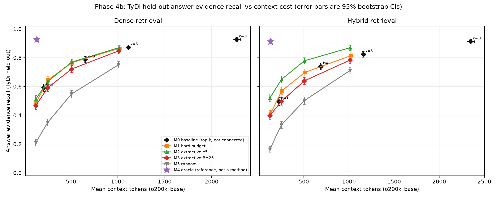
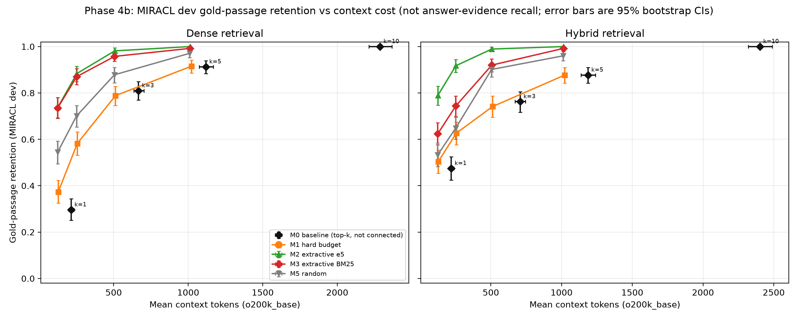

# Phase 4b: Statistical Reporting, Oracle Validation, and Finalization

## Scope and integrity

- This phase is a read-only analysis of the frozen Phase 4 per-query outputs and frozen Phase 3 rankings. No retrieval, embedding generation, embedding cache, model, dataset, or external API was used or rebuilt.
- Dense (multilingual-e5-small) is the primary retriever and the main MIRACL-train-tuned Hybrid (RRF) is secondary.
- TyDi answer-evidence results and MIRACL gold-passage-retention results are kept separate throughout. MIRACL has no answer strings, so no answer recall or answer-loss value is reported or inferred.
- Bootstrap: 10,000 question-level resamples, seed 42, percentile 95% confidence intervals. Paired comparisons use the same bootstrap replicate indices for both methods over the same question IDs.
- Source per-query records: 79,566. Aggregate rows recomputed: 120; all matched the approved Phase 4 aggregates for 120 non-M4 rows.

## 1. TyDi held-out M0 baselines (Dense)

| k | n | o200k tokens (95% CI) | e5 tokens (95% CI) | Answer recall (95% CI) | Gold retention (95% CI) | Evidence loss (95% CI) |
|---|---|---|---|---|---|---|
| 1 | 1390 | 210.0 [202.1, 218.3] | 191.1 [183.9, 198.8] | 0.5921 [0.5662, 0.6180] | 0.3802 [0.3529, 0.4084] | 0.3610 [0.3346, 0.3866] |
| 3 | 1390 | 653.6 [635.5, 672.0] | 593.8 [577.1, 610.9] | 0.7871 [0.7655, 0.8086] | 0.7528 [0.7280, 0.7775] | 0.1506 [0.1312, 0.1700] |
| 5 | 1390 | 1111.8 [1086.7, 1137.4] | 1010.8 [987.6, 1034.6] | 0.8719 [0.8540, 0.8892] | 0.8849 [0.8662, 0.9028] | 0.0590 [0.0466, 0.0722] |
| 10 | 1390 | 2268.1 [2227.9, 2307.7] | 2065.0 [2027.3, 2102.4] | 0.9266 [0.9129, 0.9403] | 1.0000 [1.0000, 1.0000] | 0.0000 [0.0000, 0.0000] |

## 2. TyDi held-out M0 baselines (Hybrid, MIRACL-tuned)

| k | n | o200k tokens (95% CI) | e5 tokens (95% CI) | Answer recall (95% CI) | Gold retention (95% CI) | Evidence loss (95% CI) |
|---|---|---|---|---|---|---|
| 1 | 1390 | 225.0 [215.5, 235.1] | 205.6 [196.9, 214.9] | 0.4964 [0.4698, 0.5230] | 0.1573 [0.1356, 0.1790] | 0.4558 [0.4282, 0.4834] |
| 3 | 1390 | 688.9 [670.0, 709.1] | 627.4 [609.7, 646.5] | 0.7396 [0.7165, 0.7626] | 0.6338 [0.6049, 0.6609] | 0.1893 [0.1680, 0.2114] |
| 5 | 1390 | 1158.6 [1133.5, 1184.8] | 1053.8 [1030.3, 1078.5] | 0.8237 [0.8036, 0.8439] | 0.8228 [0.7993, 0.8454] | 0.0970 [0.0812, 0.1144] |
| 10 | 1390 | 2348.0 [2307.4, 2390.1] | 2137.0 [2098.4, 2177.3] | 0.9122 [0.8971, 0.9266] | 1.0000 [1.0000, 1.0000] | 0.0000 [0.0000, 0.0000] |

M0 points are uncompressed top-k contexts. They are shown separately from the compression-method curves in the plot and are not connected as a compression curve.

## 3. TyDi held-out budget tables (Dense)

| Method | Budget | n | o200k tokens (95% CI) | e5 tokens (95% CI) | Answer recall (95% CI) | Gold retention (95% CI) | Evidence loss (95% CI) |
|---|---|---|---|---|---|---|---|
| M1 | 128 | 1390 | 128.0 [128.0, 128.0] | 116.6 [116.1, 117.1] | 0.4871 [0.4612, 0.5129] | 0.4552 [0.4271, 0.4842] | 0.4744 [0.4472, 0.5016] |
| M1 | 256 | 1390 | 256.0 [256.0, 256.0] | 232.1 [231.2, 233.0] | 0.6460 [0.6209, 0.6712] | 0.6172 [0.5899, 0.6454] | 0.3028 [0.2772, 0.3284] |
| M1 | 512 | 1390 | 512.0 [512.0, 512.0] | 463.9 [462.3, 465.5] | 0.7662 [0.7439, 0.7885] | 0.7553 [0.7306, 0.7801] | 0.1731 [0.1522, 0.1933] |
| M1 | 1024 | 1390 | 1020.3 [1018.4, 1021.9] | 926.3 [923.0, 929.5] | 0.8655 [0.8468, 0.8835] | 0.9020 [0.8849, 0.9190] | 0.0660 [0.0528, 0.0800] |
| M2 | 128 | 1390 | 125.0 [124.8, 125.2] | 112.1 [111.6, 112.7] | 0.5115 [0.4849, 0.5381] | 0.6300 [0.6027, 0.6581] | 0.4480 [0.4208, 0.4759] |
| M2 | 256 | 1390 | 252.7 [252.4, 252.9] | 225.9 [224.9, 226.9] | 0.6345 [0.6086, 0.6597] | 0.8107 [0.7877, 0.8329] | 0.3152 [0.2896, 0.3408] |
| M2 | 512 | 1390 | 507.4 [507.1, 507.6] | 455.4 [453.6, 457.1] | 0.7691 [0.7468, 0.7906] | 0.9497 [0.9369, 0.9616] | 0.1700 [0.1491, 0.1918] |
| M2 | 1024 | 1390 | 1011.6 [1009.8, 1013.2] | 912.3 [908.8, 915.7] | 0.8698 [0.8518, 0.8871] | 0.9991 [0.9974, 1.0000] | 0.0613 [0.0481, 0.0753] |
| M3 | 128 | 1390 | 124.8 [124.6, 125.0] | 113.1 [112.5, 113.7] | 0.4662 [0.4403, 0.4921] | 0.5976 [0.5695, 0.6257] | 0.4969 [0.4697, 0.5241] |
| M3 | 256 | 1390 | 251.9 [251.7, 252.2] | 227.1 [226.2, 228.1] | 0.5906 [0.5640, 0.6165] | 0.7775 [0.7536, 0.8014] | 0.3626 [0.3369, 0.3890] |
| M3 | 512 | 1390 | 506.0 [505.6, 506.3] | 456.4 [454.7, 458.1] | 0.7209 [0.6971, 0.7439] | 0.9156 [0.8994, 0.9318] | 0.2220 [0.1995, 0.2446] |
| M3 | 1024 | 1390 | 1009.6 [1007.8, 1011.2] | 913.5 [910.1, 916.7] | 0.8475 [0.8281, 0.8662] | 0.9864 [0.9795, 0.9923] | 0.0854 [0.0707, 0.1017] |
| M5 | 128 | 1390 | 124.3 [124.1, 124.6] | 113.7 [113.1, 114.2] | 0.2094 [0.1878, 0.2309] | 0.4714 [0.4425, 0.4996] | 0.7741 [0.7508, 0.7974] |
| M5 | 256 | 1390 | 251.6 [251.3, 251.8] | 228.7 [227.9, 229.5] | 0.3496 [0.3259, 0.3755] | 0.6249 [0.5976, 0.6522] | 0.6227 [0.5955, 0.6491] |
| M5 | 512 | 1390 | 505.5 [505.2, 505.7] | 458.8 [457.4, 460.1] | 0.5475 [0.5209, 0.5741] | 0.8269 [0.8048, 0.8483] | 0.4092 [0.3827, 0.4363] |
| M5 | 1024 | 1390 | 1008.5 [1006.6, 1010.1] | 916.7 [913.5, 919.6] | 0.7511 [0.7281, 0.7734] | 0.9668 [0.9565, 0.9761] | 0.1894 [0.1677, 0.2112] |

## 4. TyDi held-out budget tables (Hybrid, MIRACL-tuned)

| Method | Budget | n | o200k tokens (95% CI) | e5 tokens (95% CI) | Answer recall (95% CI) | Gold retention (95% CI) | Evidence loss (95% CI) |
|---|---|---|---|---|---|---|---|
| M1 | 128 | 1390 | 128.0 [128.0, 128.0] | 117.3 [116.8, 117.8] | 0.4079 [0.3820, 0.4338] | 0.2324 [0.2071, 0.2577] | 0.5528 [0.5260, 0.5797] |
| M1 | 256 | 1390 | 256.0 [256.0, 256.0] | 233.1 [232.3, 234.0] | 0.5698 [0.5439, 0.5957] | 0.4186 [0.3888, 0.4476] | 0.3754 [0.3486, 0.4022] |
| M1 | 512 | 1390 | 512.0 [512.0, 512.0] | 465.3 [463.8, 466.9] | 0.6978 [0.6734, 0.7216] | 0.6239 [0.5949, 0.6519] | 0.2350 [0.2121, 0.2587] |
| M1 | 1024 | 1390 | 1023.1 [1022.3, 1023.8] | 929.4 [926.4, 932.2] | 0.8144 [0.7942, 0.8338] | 0.8291 [0.8065, 0.8508] | 0.1073 [0.0907, 0.1246] |
| M2 | 128 | 1390 | 125.0 [124.8, 125.2] | 112.5 [111.9, 113.1] | 0.5209 [0.4942, 0.5468] | 0.6465 [0.6175, 0.6745] | 0.4290 [0.4022, 0.4558] |
| M2 | 256 | 1390 | 252.6 [252.3, 252.8] | 226.5 [225.5, 227.5] | 0.6489 [0.6237, 0.6734] | 0.8535 [0.8318, 0.8743] | 0.2886 [0.2642, 0.3131] |
| M2 | 512 | 1390 | 506.6 [506.3, 506.9] | 455.2 [453.5, 457.0] | 0.7784 [0.7568, 0.8000] | 0.9638 [0.9530, 0.9747] | 0.1467 [0.1270, 0.1656] |
| M2 | 1024 | 1390 | 1013.8 [1012.9, 1014.6] | 914.8 [911.5, 917.9] | 0.8698 [0.8518, 0.8871] | 0.9982 [0.9955, 1.0000] | 0.0465 [0.0355, 0.0584] |
| M3 | 128 | 1390 | 124.9 [124.7, 125.0] | 113.0 [112.5, 113.6] | 0.3986 [0.3734, 0.4237] | 0.4964 [0.4675, 0.5262] | 0.5631 [0.5355, 0.5907] |
| M3 | 256 | 1390 | 252.2 [252.0, 252.4] | 227.3 [226.3, 228.2] | 0.4971 [0.4712, 0.5237] | 0.6401 [0.6112, 0.6682] | 0.4550 [0.4274, 0.4819] |
| M3 | 512 | 1390 | 506.2 [505.9, 506.5] | 456.4 [454.8, 458.1] | 0.6388 [0.6137, 0.6640] | 0.8418 [0.8201, 0.8626] | 0.2997 [0.2744, 0.3249] |
| M3 | 1024 | 1390 | 1012.8 [1011.9, 1013.5] | 915.8 [912.6, 918.8] | 0.7835 [0.7619, 0.8043] | 0.9810 [0.9729, 0.9882] | 0.1412 [0.1222, 0.1601] |
| M5 | 128 | 1390 | 124.3 [124.1, 124.6] | 113.5 [113.0, 114.0] | 0.1633 [0.1439, 0.1820] | 0.4647 [0.4358, 0.4946] | 0.8210 [0.7997, 0.8415] |
| M5 | 256 | 1390 | 251.4 [251.1, 251.6] | 228.5 [227.7, 229.3] | 0.3338 [0.3094, 0.3583] | 0.6329 [0.6049, 0.6609] | 0.6341 [0.6073, 0.6609] |
| M5 | 512 | 1390 | 505.3 [505.1, 505.6] | 458.9 [457.5, 460.3] | 0.5014 [0.4748, 0.5281] | 0.8165 [0.7939, 0.8391] | 0.4503 [0.4227, 0.4779] |
| M5 | 1024 | 1390 | 1011.1 [1010.2, 1011.8] | 918.3 [915.5, 920.9] | 0.7108 [0.6871, 0.7338] | 0.9539 [0.9412, 0.9656] | 0.2208 [0.1987, 0.2437] |

Evidence-loss denominators are questions where M0 top-10 contained the gold answer. Answer-recall denominators are all TyDi held-out questions. Gold-retention denominators are questions where a gold passage is in M0 top-10.

## 5. Paired bootstrap differences (TyDi held-out, answer evidence)

Positive differences mean the first method has higher answer-evidence recall. A difference is called statistically significant only when its two-sided 95% CI excludes zero.

### Dense

| Comparison | Budget | n | Mean diff (pp) | 95% CI (pp) | Includes zero | Significant |
|---|---|---|---|---|---|---|
| M2-M1 | 128 | 1390 | +2.45 | [-0.50, 5.47] | yes | no |
| M2-M5 | 128 | 1390 | +30.22 | [27.12, 33.31] | no | yes |
| M3-M2 | 128 | 1390 | -4.53 | [-7.27, -1.87] | no | yes |
| M2-M1 | 256 | 1390 | -1.15 | [-3.96, 1.58] | yes | no |
| M2-M5 | 256 | 1390 | +28.49 | [25.18, 31.80] | no | yes |
| M3-M2 | 256 | 1390 | -4.39 | [-6.98, -1.80] | no | yes |
| M2-M1 | 512 | 1390 | +0.29 | [-2.09, 2.66] | yes | no |
| M2-M5 | 512 | 1390 | +22.16 | [19.21, 25.11] | no | yes |
| M3-M2 | 512 | 1390 | -4.82 | [-7.12, -2.52] | no | yes |
| M2-M1 | 1024 | 1390 | +0.43 | [-1.08, 1.94] | yes | no |
| M2-M5 | 1024 | 1390 | +11.87 | [9.78, 14.10] | no | yes |
| M3-M2 | 1024 | 1390 | -2.23 | [-3.74, -0.72] | no | yes |

### Hybrid

| Comparison | Budget | n | Mean diff (pp) | 95% CI (pp) | Includes zero | Significant |
|---|---|---|---|---|---|---|
| M2-M1 | 128 | 1390 | +11.29 | [8.20, 14.39] | no | yes |
| M2-M5 | 128 | 1390 | +35.76 | [32.81, 38.63] | no | yes |
| M3-M2 | 128 | 1390 | -12.23 | [-15.04, -9.42] | no | yes |
| M2-M1 | 256 | 1390 | +7.91 | [4.89, 10.94] | no | yes |
| M2-M5 | 256 | 1390 | +31.51 | [28.35, 34.68] | no | yes |
| M3-M2 | 256 | 1390 | -15.18 | [-17.91, -12.37] | no | yes |
| M2-M1 | 512 | 1390 | +8.06 | [5.47, 10.65] | no | yes |
| M2-M5 | 512 | 1390 | +27.70 | [24.75, 30.58] | no | yes |
| M3-M2 | 512 | 1390 | -13.96 | [-16.40, -11.51] | no | yes |
| M2-M1 | 1024 | 1390 | +5.54 | [3.81, 7.27] | no | yes |
| M2-M5 | 1024 | 1390 | +15.90 | [13.67, 18.20] | no | yes |
| M3-M2 | 1024 | 1390 | -8.63 | [-10.36, -6.91] | no | yes |

## 6. TyDi validation (secondary)

### M0 (Dense)

| k | n | o200k tokens (95% CI) | e5 tokens (95% CI) | Answer recall (95% CI) | Gold retention (95% CI) | Evidence loss (95% CI) |
|---|---|---|---|---|---|---|
| 1 | 113 | 208.4 [188.8, 229.6] | 192.6 [173.4, 214.0] | 0.7257 [0.6460, 0.8053] | 0.5743 [0.4752, 0.6733] | 0.2336 [0.1589, 0.3178] |
| 3 | 113 | 694.0 [632.3, 762.6] | 637.3 [579.6, 701.0] | 0.9027 [0.8496, 0.9558] | 0.8713 [0.8020, 0.9307] | 0.0467 [0.0093, 0.0935] |
| 5 | 113 | 1168.5 [1074.0, 1271.4] | 1070.9 [981.4, 1168.7] | 0.9292 [0.8761, 0.9735] | 0.9307 [0.8812, 0.9802] | 0.0187 [0.0000, 0.0467] |
| 10 | 113 | 2414.6 [2259.7, 2575.6] | 2212.8 [2063.3, 2366.8] | 0.9469 [0.9027, 0.9823] | 1.0000 [1.0000, 1.0000] | 0.0000 [0.0000, 0.0000] |

### M0 (Hybrid)

| k | n | o200k tokens (95% CI) | e5 tokens (95% CI) | Answer recall (95% CI) | Gold retention (95% CI) | Evidence loss (95% CI) |
|---|---|---|---|---|---|---|
| 1 | 113 | 222.9 [198.6, 250.4] | 205.6 [183.2, 231.2] | 0.5487 [0.4602, 0.6372] | 0.3100 [0.2200, 0.4000] | 0.4206 [0.3271, 0.5140] |
| 3 | 113 | 691.2 [635.1, 752.3] | 634.6 [580.8, 693.0] | 0.7876 [0.7080, 0.8584] | 0.7200 [0.6300, 0.8100] | 0.1682 [0.1028, 0.2430] |
| 5 | 113 | 1174.9 [1083.3, 1274.1] | 1074.2 [986.9, 1169.5] | 0.8938 [0.8319, 0.9469] | 0.9000 [0.8400, 0.9600] | 0.0561 [0.0187, 0.1028] |
| 10 | 113 | 2379.6 [2238.0, 2529.7] | 2171.7 [2034.3, 2316.8] | 0.9469 [0.9027, 0.9823] | 1.0000 [1.0000, 1.0000] | 0.0000 [0.0000, 0.0000] |

### Budgets (Dense)

| Method | Budget | n | o200k tokens (95% CI) | e5 tokens (95% CI) | Answer recall (95% CI) | Gold retention (95% CI) | Evidence loss (95% CI) |
|---|---|---|---|---|---|---|---|
| M1 | 128 | 113 | 128.0 [128.0, 128.0] | 116.8 [115.1, 118.6] | 0.6195 [0.5310, 0.7080] | 0.6634 [0.5644, 0.7525] | 0.3458 [0.2617, 0.4393] |
| M1 | 256 | 113 | 256.0 [256.0, 256.0] | 234.1 [230.9, 237.2] | 0.7699 [0.6903, 0.8407] | 0.7723 [0.6832, 0.8515] | 0.1869 [0.1121, 0.2617] |
| M1 | 512 | 113 | 512.0 [512.0, 512.0] | 468.5 [462.9, 474.0] | 0.8496 [0.7788, 0.9115] | 0.8713 [0.8020, 0.9307] | 0.1028 [0.0467, 0.1591] |
| M1 | 1024 | 113 | 1021.8 [1018.7, 1024.0] | 929.7 [919.6, 940.1] | 0.9204 [0.8673, 0.9646] | 0.9505 [0.9010, 0.9901] | 0.0280 [0.0000, 0.0654] |
| M2 | 128 | 113 | 125.5 [125.0, 126.0] | 113.0 [110.7, 115.2] | 0.4956 [0.4071, 0.5841] | 0.7426 [0.6535, 0.8218] | 0.4766 [0.3832, 0.5701] |
| M2 | 256 | 113 | 252.9 [252.4, 253.4] | 227.5 [223.8, 231.2] | 0.6195 [0.5310, 0.7080] | 0.8911 [0.8317, 0.9505] | 0.3458 [0.2523, 0.4393] |
| M2 | 512 | 113 | 507.0 [505.4, 508.2] | 457.9 [451.2, 464.5] | 0.7257 [0.6372, 0.8053] | 0.9901 [0.9703, 1.0000] | 0.2336 [0.1589, 0.3178] |
| M2 | 1024 | 113 | 1013.1 [1010.0, 1015.5] | 917.8 [906.3, 929.2] | 0.8584 [0.7876, 0.9204] | 0.9901 [0.9703, 1.0000] | 0.0935 [0.0467, 0.1495] |
| M3 | 128 | 113 | 124.7 [124.2, 125.3] | 111.8 [109.7, 113.9] | 0.4159 [0.3274, 0.5044] | 0.6733 [0.5842, 0.7624] | 0.5607 [0.4673, 0.6542] |
| M3 | 256 | 113 | 252.3 [251.6, 252.9] | 226.5 [223.3, 229.7] | 0.5398 [0.4513, 0.6283] | 0.7822 [0.7030, 0.8614] | 0.4299 [0.3364, 0.5234] |
| M3 | 512 | 113 | 506.2 [505.4, 506.9] | 458.0 [452.1, 463.9] | 0.6814 [0.5929, 0.7699] | 0.9406 [0.8911, 0.9802] | 0.2804 [0.1963, 0.3645] |
| M3 | 1024 | 113 | 1011.6 [1008.6, 1013.9] | 920.3 [909.7, 930.9] | 0.8584 [0.7876, 0.9204] | 1.0000 [1.0000, 1.0000] | 0.0935 [0.0467, 0.1495] |
| M5 | 128 | 113 | 124.4 [123.5, 125.1] | 113.5 [111.7, 115.3] | 0.1770 [0.1062, 0.2478] | 0.4653 [0.3663, 0.5644] | 0.8131 [0.7383, 0.8879] |
| M5 | 256 | 113 | 251.8 [250.6, 252.7] | 228.4 [225.5, 231.2] | 0.3451 [0.2566, 0.4336] | 0.6436 [0.5545, 0.7327] | 0.6355 [0.5421, 0.7290] |
| M5 | 512 | 113 | 506.4 [505.7, 507.0] | 459.1 [454.2, 463.9] | 0.5310 [0.4425, 0.6195] | 0.8812 [0.8119, 0.9406] | 0.4393 [0.3458, 0.5327] |
| M5 | 1024 | 113 | 1010.5 [1007.5, 1012.7] | 920.6 [911.1, 930.2] | 0.6549 [0.5664, 0.7434] | 0.9604 [0.9208, 0.9901] | 0.3084 [0.2243, 0.4019] |

### Budgets (Hybrid)

| Method | Budget | n | o200k tokens (95% CI) | e5 tokens (95% CI) | Answer recall (95% CI) | Gold retention (95% CI) | Evidence loss (95% CI) |
|---|---|---|---|---|---|---|---|
| M1 | 128 | 113 | 128.0 [128.0, 128.0] | 117.0 [115.3, 118.7] | 0.4336 [0.3451, 0.5221] | 0.3900 [0.2900, 0.4900] | 0.5421 [0.4486, 0.6355] |
| M1 | 256 | 113 | 256.0 [256.0, 256.0] | 233.7 [230.7, 236.7] | 0.6106 [0.5221, 0.6991] | 0.5300 [0.4300, 0.6300] | 0.3551 [0.2617, 0.4486] |
| M1 | 512 | 113 | 512.0 [512.0, 512.0] | 465.7 [459.8, 471.3] | 0.7522 [0.6726, 0.8319] | 0.7300 [0.6400, 0.8200] | 0.2056 [0.1308, 0.2804] |
| M1 | 1024 | 113 | 1022.4 [1019.2, 1024.0] | 929.6 [918.6, 940.3] | 0.8584 [0.7876, 0.9204] | 0.8900 [0.8300, 0.9500] | 0.0935 [0.0467, 0.1495] |
| M2 | 128 | 113 | 124.9 [124.2, 125.7] | 112.0 [109.7, 114.2] | 0.5044 [0.4159, 0.5929] | 0.7100 [0.6200, 0.8000] | 0.4673 [0.3738, 0.5607] |
| M2 | 256 | 113 | 251.7 [250.6, 252.6] | 226.5 [222.9, 230.1] | 0.6106 [0.5221, 0.6991] | 0.9000 [0.8400, 0.9500] | 0.3551 [0.2710, 0.4486] |
| M2 | 512 | 113 | 507.3 [506.4, 508.0] | 457.8 [450.9, 464.5] | 0.7611 [0.6814, 0.8407] | 0.9800 [0.9500, 1.0000] | 0.1963 [0.1215, 0.2710] |
| M2 | 1024 | 113 | 1013.1 [1009.4, 1015.4] | 915.7 [903.4, 927.6] | 0.8761 [0.8142, 0.9381] | 1.0000 [1.0000, 1.0000] | 0.0748 [0.0280, 0.1308] |
| M3 | 128 | 113 | 124.6 [123.4, 125.5] | 112.5 [110.2, 114.7] | 0.3274 [0.2389, 0.4159] | 0.5800 [0.4800, 0.6800] | 0.6542 [0.5607, 0.7383] |
| M3 | 256 | 113 | 251.6 [250.7, 252.4] | 226.0 [222.1, 229.7] | 0.4336 [0.3451, 0.5221] | 0.7000 [0.6100, 0.7900] | 0.5421 [0.4486, 0.6355] |
| M3 | 512 | 113 | 506.6 [506.0, 507.3] | 456.9 [450.4, 463.2] | 0.5664 [0.4690, 0.6549] | 0.8800 [0.8100, 0.9400] | 0.4019 [0.3084, 0.4953] |
| M3 | 1024 | 113 | 1012.0 [1008.4, 1014.3] | 918.3 [906.8, 929.5] | 0.7699 [0.6903, 0.8407] | 0.9700 [0.9300, 1.0000] | 0.1869 [0.1121, 0.2617] |
| M5 | 128 | 113 | 124.3 [123.6, 125.0] | 113.9 [112.3, 115.5] | 0.1858 [0.1150, 0.2566] | 0.5800 [0.4800, 0.6800] | 0.8037 [0.7290, 0.8785] |
| M5 | 256 | 113 | 251.4 [250.5, 252.1] | 227.5 [224.6, 230.4] | 0.3540 [0.2655, 0.4425] | 0.7100 [0.6200, 0.8000] | 0.6262 [0.5327, 0.7196] |
| M5 | 512 | 113 | 505.1 [504.3, 505.8] | 459.8 [455.1, 464.5] | 0.4248 [0.3363, 0.5133] | 0.8600 [0.7900, 0.9200] | 0.5514 [0.4579, 0.6449] |
| M5 | 1024 | 113 | 1011.1 [1007.6, 1013.3] | 918.2 [907.9, 928.4] | 0.6903 [0.6018, 0.7699] | 0.9700 [0.9300, 1.0000] | 0.2710 [0.1869, 0.3551] |

### Paired differences (Dense)

| Comparison | Budget | n | Mean diff (pp) | 95% CI (pp) | Includes zero | Significant |
|---|---|---|---|---|---|---|
| M2-M1 | 128 | 113 | -12.39 | [-22.12, -1.77] | no | yes |
| M2-M5 | 128 | 113 | +31.86 | [20.35, 43.36] | no | yes |
| M3-M2 | 128 | 113 | -7.96 | [-17.70, 0.88] | yes | no |
| M2-M1 | 256 | 113 | -15.04 | [-23.89, -6.19] | no | yes |
| M2-M5 | 256 | 113 | +27.43 | [15.93, 38.94] | no | yes |
| M3-M2 | 256 | 113 | -7.96 | [-16.81, 0.88] | yes | no |
| M2-M1 | 512 | 113 | -12.39 | [-20.35, -4.42] | no | yes |
| M2-M5 | 512 | 113 | +19.47 | [7.96, 30.97] | no | yes |
| M3-M2 | 512 | 113 | -4.42 | [-12.39, 3.54] | yes | no |
| M2-M1 | 1024 | 113 | -6.19 | [-11.50, -0.88] | no | yes |
| M2-M5 | 1024 | 113 | +20.35 | [10.62, 30.09] | no | yes |
| M3-M2 | 1024 | 113 | +0.00 | [-6.19, 6.19] | yes | no |

### Paired differences (Hybrid)

| Comparison | Budget | n | Mean diff (pp) | 95% CI (pp) | Includes zero | Significant |
|---|---|---|---|---|---|---|
| M2-M1 | 128 | 113 | +7.08 | [-3.54, 17.70] | yes | no |
| M2-M5 | 128 | 113 | +31.86 | [20.35, 43.36] | no | yes |
| M3-M2 | 128 | 113 | -17.70 | [-27.43, -7.96] | no | yes |
| M2-M1 | 256 | 113 | +0.00 | [-9.73, 10.62] | yes | no |
| M2-M5 | 256 | 113 | +25.66 | [14.16, 37.17] | no | yes |
| M3-M2 | 256 | 113 | -17.70 | [-26.55, -8.85] | no | yes |
| M2-M1 | 512 | 113 | +0.88 | [-8.85, 10.62] | yes | no |
| M2-M5 | 512 | 113 | +33.63 | [23.01, 44.25] | no | yes |
| M3-M2 | 512 | 113 | -19.47 | [-27.43, -12.39] | no | yes |
| M2-M1 | 1024 | 113 | +1.77 | [-5.31, 8.85] | yes | no |
| M2-M5 | 1024 | 113 | +18.58 | [9.73, 27.43] | no | yes |
| M3-M2 | 1024 | 113 | -10.62 | [-17.70, -3.54] | no | yes |

## 7. MIRACL dev (Dense)

MIRACL reports only gold-passage retention and token cost. Answer recall and answer-evidence loss are not reported.

### M0

| k | n | o200k tokens (95% CI) | e5 tokens (95% CI) | Gold retention (95% CI) |
|---|---|---|---|---|
| 1 | 411 | 214.4 [198.1, 234.0] | 195.3 [180.1, 213.5] | 0.2963 [0.2513, 0.3439] |
| 3 | 411 | 667.0 [634.7, 702.7] | 606.1 [576.0, 639.4] | 0.8095 [0.7698, 0.8492] |
| 5 | 411 | 1118.4 [1073.1, 1169.0] | 1017.3 [975.0, 1064.1] | 0.9127 [0.8836, 0.9392] |
| 10 | 411 | 2287.1 [2211.3, 2367.2] | 2084.9 [2013.6, 2159.3] | 1.0000 [1.0000, 1.0000] |

### Budgets

| Method | Budget | n | o200k tokens (95% CI) | e5 tokens (95% CI) | Gold retention (95% CI) |
|---|---|---|---|---|---|
| M1 | 128 | 411 | 128.0 [128.0, 128.0] | 116.9 [116.0, 117.8] | 0.3730 [0.3254, 0.4233] |
| M1 | 256 | 411 | 256.0 [256.0, 256.0] | 232.6 [231.1, 234.2] | 0.5820 [0.5317, 0.6323] |
| M1 | 512 | 411 | 512.0 [512.0, 512.0] | 464.6 [461.8, 467.4] | 0.7884 [0.7460, 0.8280] |
| M1 | 1024 | 411 | 1022.0 [1020.0, 1023.6] | 929.0 [923.6, 934.1] | 0.9153 [0.8862, 0.9418] |
| M2 | 128 | 411 | 125.2 [124.8, 125.5] | 113.5 [112.5, 114.5] | 0.7381 [0.6931, 0.7804] |
| M2 | 256 | 411 | 252.7 [252.2, 253.1] | 227.6 [225.8, 229.3] | 0.8836 [0.8492, 0.9153] |
| M2 | 512 | 411 | 507.4 [506.9, 507.8] | 457.3 [454.1, 460.4] | 0.9815 [0.9656, 0.9947] |
| M2 | 1024 | 411 | 1013.1 [1011.2, 1014.8] | 916.6 [910.6, 922.4] | 1.0000 [1.0000, 1.0000] |
| M3 | 128 | 411 | 124.8 [124.5, 125.1] | 113.5 [112.5, 114.5] | 0.7354 [0.6905, 0.7804] |
| M3 | 256 | 411 | 252.1 [251.8, 252.5] | 228.1 [226.4, 229.8] | 0.8704 [0.8360, 0.9048] |
| M3 | 512 | 411 | 506.2 [505.5, 506.7] | 457.7 [454.7, 460.7] | 0.9577 [0.9365, 0.9762] |
| M3 | 1024 | 411 | 1011.0 [1009.1, 1012.7] | 916.9 [911.1, 922.6] | 0.9921 [0.9815, 1.0000] |
| M5 | 128 | 411 | 124.4 [124.0, 124.8] | 113.8 [112.9, 114.7] | 0.5450 [0.4947, 0.5926] |
| M5 | 256 | 411 | 251.3 [250.6, 251.8] | 229.1 [227.6, 230.6] | 0.7011 [0.6534, 0.7460] |
| M5 | 512 | 411 | 505.3 [504.9, 505.7] | 460.2 [457.6, 462.7] | 0.8783 [0.8439, 0.9101] |
| M5 | 1024 | 411 | 1009.7 [1007.8, 1011.3] | 920.0 [914.9, 925.0] | 0.9709 [0.9524, 0.9868] |

## 8. MIRACL dev (Hybrid)

### M0

| k | n | o200k tokens (95% CI) | e5 tokens (95% CI) | Gold retention (95% CI) |
|---|---|---|---|---|
| 1 | 411 | 219.6 [203.2, 238.4] | 201.4 [186.1, 219.1] | 0.4747 [0.4240, 0.5253] |
| 3 | 411 | 706.8 [671.7, 744.2] | 643.9 [611.2, 678.9] | 0.7627 [0.7173, 0.8053] |
| 5 | 411 | 1186.2 [1138.3, 1238.3] | 1081.1 [1035.9, 1129.8] | 0.8773 [0.8427, 0.9093] |
| 10 | 411 | 2401.5 [2320.5, 2488.2] | 2189.4 [2111.3, 2273.6] | 1.0000 [1.0000, 1.0000] |

### Budgets

| Method | Budget | n | o200k tokens (95% CI) | e5 tokens (95% CI) | Gold retention (95% CI) |
|---|---|---|---|---|---|
| M1 | 128 | 411 | 128.0 [128.0, 128.0] | 117.8 [116.9, 118.7] | 0.5040 [0.4533, 0.5547] |
| M1 | 256 | 411 | 256.0 [256.0, 256.0] | 233.6 [232.0, 235.1] | 0.6267 [0.5760, 0.6747] |
| M1 | 512 | 411 | 512.0 [512.0, 512.0] | 465.6 [462.9, 468.3] | 0.7413 [0.6960, 0.7867] |
| M1 | 1024 | 411 | 1023.2 [1021.9, 1024.0] | 931.0 [926.0, 936.0] | 0.8773 [0.8427, 0.9093] |
| M2 | 128 | 411 | 125.1 [124.7, 125.4] | 113.5 [112.5, 114.5] | 0.7893 [0.7467, 0.8293] |
| M2 | 256 | 411 | 252.7 [252.4, 253.0] | 227.8 [226.1, 229.6] | 0.9173 [0.8880, 0.9440] |
| M2 | 512 | 411 | 506.7 [506.2, 507.2] | 457.2 [454.0, 460.3] | 0.9893 [0.9787, 0.9973] |
| M2 | 1024 | 411 | 1013.8 [1012.3, 1015.0] | 917.7 [912.0, 923.4] | 1.0000 [1.0000, 1.0000] |
| M3 | 128 | 411 | 124.8 [124.5, 125.1] | 114.0 [113.0, 114.9] | 0.6240 [0.5760, 0.6720] |
| M3 | 256 | 411 | 252.3 [251.9, 252.6] | 229.4 [227.6, 231.1] | 0.7440 [0.6987, 0.7867] |
| M3 | 512 | 411 | 506.7 [506.2, 507.1] | 459.6 [456.5, 462.7] | 0.9200 [0.8907, 0.9467] |
| M3 | 1024 | 411 | 1012.8 [1011.4, 1013.9] | 918.0 [912.5, 923.5] | 0.9920 [0.9813, 1.0000] |
| M5 | 128 | 411 | 124.3 [123.9, 124.7] | 113.8 [112.9, 114.7] | 0.5333 [0.4827, 0.5840] |
| M5 | 256 | 411 | 251.4 [250.9, 251.8] | 229.0 [227.5, 230.4] | 0.6480 [0.6000, 0.6960] |
| M5 | 512 | 411 | 505.3 [504.9, 505.7] | 459.6 [457.0, 462.2] | 0.9013 [0.8693, 0.9307] |
| M5 | 1024 | 411 | 1011.5 [1010.2, 1012.5] | 921.5 [916.5, 926.4] | 0.9600 [0.9387, 0.9787] |

## 9. MIRACL paired gold-passage-retention differences

These are **gold-passage-retention differences**, not answer-evidence differences. MIRACL has no gold answer strings.

Paired MIRACL retention comparisons are restricted to questions whose gold passage was in the M0 top-10, because retention is undefined otherwise; n is therefore the gold-retention denominator (378 for Dense, 375 for Hybrid), not the full 411-question set.

### Dense

| Comparison | Budget | n | Mean diff (pp) | 95% CI (pp) | Includes zero | Significant |
|---|---|---|---|---|---|---|
| M2-M1 | 128 | 378 | +36.51 | [30.95, 41.80] | no | yes |
| M2-M5 | 128 | 378 | +19.31 | [13.23, 25.40] | no | yes |
| M3-M2 | 128 | 378 | -0.26 | [-5.29, 4.76] | yes | no |
| M2-M1 | 256 | 378 | +30.16 | [24.87, 35.45] | no | yes |
| M2-M5 | 256 | 378 | +18.25 | [12.96, 23.54] | no | yes |
| M3-M2 | 256 | 378 | -1.32 | [-5.29, 2.65] | yes | no |
| M2-M1 | 512 | 378 | +19.31 | [15.34, 23.28] | no | yes |
| M2-M5 | 512 | 378 | +10.32 | [7.14, 13.76] | no | yes |
| M3-M2 | 512 | 378 | -2.38 | [-4.50, -0.26] | no | yes |
| M2-M1 | 1024 | 378 | +8.47 | [5.82, 11.38] | no | yes |
| M2-M5 | 1024 | 378 | +2.91 | [1.32, 4.76] | no | yes |
| M3-M2 | 1024 | 378 | -0.79 | [-1.85, 0.00] | yes | no |

### Hybrid

| Comparison | Budget | n | Mean diff (pp) | 95% CI (pp) | Includes zero | Significant |
|---|---|---|---|---|---|---|
| M2-M1 | 128 | 375 | +28.53 | [23.20, 33.87] | no | yes |
| M2-M5 | 128 | 375 | +25.60 | [19.20, 31.73] | no | yes |
| M3-M2 | 128 | 375 | -16.53 | [-21.87, -11.20] | no | yes |
| M2-M1 | 256 | 375 | +29.07 | [24.27, 33.87] | no | yes |
| M2-M5 | 256 | 375 | +26.93 | [21.60, 32.27] | no | yes |
| M3-M2 | 256 | 375 | -17.33 | [-22.40, -12.27] | no | yes |
| M2-M1 | 512 | 375 | +24.80 | [20.53, 29.33] | no | yes |
| M2-M5 | 512 | 375 | +8.80 | [5.60, 12.00] | no | yes |
| M3-M2 | 512 | 375 | -6.93 | [-9.87, -4.00] | no | yes |
| M2-M1 | 1024 | 375 | +12.27 | [9.07, 15.73] | no | yes |
| M2-M5 | 1024 | 375 | +4.00 | [2.13, 6.13] | no | yes |
| M3-M2 | 1024 | 375 | -0.80 | [-1.87, 0.00] | yes | no |

## 10. Oracle M4 validation (TyDi only)

M4 was recomputed with the minimum unique answer-bearing sentence rule: split with the established splitter, normalize with NFC and Bangla/ASCII digit mapping, deduplicate identical normalized sentences, preserve original text and order, and keep all genuinely distinct answer-bearing sentences. M4 remains an oracle lower bound and is not an ordinary budgeted method.

### Token statistics

| Dataset | Retriever | n | o200k mean [95% CI] | o200k median | o200k min | o200k max | e5 mean [95% CI] | e5 median | e5 min | e5 max | Previous mean o200k | Difference |
|---|---|---|---|---|---|---|---|---|---|---|---|---|
| tydi_heldout | Dense | 1390 | 135.3 [126.2, 144.6] | 70.5 | 0 | 2457 | 122.9 [114.8, 131.3] | 65.0 | 0 | 2101 | 167.5 | -32.1 |
| tydi_heldout | Hybrid | 1390 | 130.2 [122.0, 138.6] | 69.0 | 0 | 1155 | 118.5 [111.0, 126.1] | 64.0 | 0 | 1111 | 159.9 | -29.7 |
| tydi_validation | Dense | 113 | 112.5 [91.1, 136.2] | 80.0 | 0 | 682 | 105.7 [85.4, 128.3] | 74.0 | 0 | 665 | 133.5 | -21.0 |
| tydi_validation | Hybrid | 113 | 112.6 [91.3, 136.2] | 80.0 | 0 | 708 | 105.2 [84.8, 128.4] | 73.0 | 0 | 746 | 131.6 | -19.0 |

### Sentence-selection statistics

| Dataset | Retriever | n | Mean selected unique sentences | Zero matches n (%) | >1 unique sentence n (%) | Questions with gold answers |
|---|---|---|---|---|---|---|
| tydi_heldout | Dense | 1390 | 3.197 | 103 (7.41%) | 778 (55.97%) | 1390 |
| tydi_heldout | Hybrid | 1390 | 3.050 | 123 (8.85%) | 758 (54.53%) | 1390 |
| tydi_validation | Dense | 113 | 2.796 | 6 (5.31%) | 60 (53.10%) | 113 |
| tydi_validation | Hybrid | 113 | 2.735 | 6 (5.31%) | 58 (51.33%) | 113 |

### Comparison with the previous 167.5-token result

- tydi_heldout / Dense: recomputed mean 135.3 vs previous 167.5 o200k tokens (-32.1). The difference is due to deduplicating identical normalized answer-bearing sentences across the ten retrieved passages, not to a change in answer matching.
- tydi_heldout / Hybrid: recomputed mean 130.2 vs previous 159.9 o200k tokens (-29.7). The difference is due to deduplicating identical normalized answer-bearing sentences across the ten retrieved passages, not to a change in answer matching.
- tydi_validation / Dense: recomputed mean 112.5 vs previous 133.5 o200k tokens (-21.0). The difference is due to deduplicating identical normalized answer-bearing sentences across the ten retrieved passages, not to a change in answer matching.
- tydi_validation / Hybrid: recomputed mean 112.6 vs previous 131.6 o200k tokens (-19.0). The difference is due to deduplicating identical normalized answer-bearing sentences across the ten retrieved passages, not to a change in answer matching.

### Examples with multiple unique answer-bearing sentences

**Example 1** (tydi_heldout / Dense / `tydi_bengali-7478984229355295611-0`)

- Question: জাতিসংঘ শান্তিরক্ষা মিশন প্রথম কোথায় শুরু হয় ?
- Gold answer(s): মধ্যপ্রাচ্যে
- Selected unique sentences: 2
- o200k tokens: 86; e5 tokens: 73

```text
এর প্রথম মিশন ছিল ১৯৪৮ সালে মধ্যপ্রাচ্যে ১৯৪৮ আরব-ইসরায়েলি যুদ্ধের সময় যুদ্ধবিরতি পালন ও বজায় রাখা।

প্রথমে শান্তিরক্ষা মিশন আরব-ইসরায়েলি যুদ্ধের সময় ১৯৪৮ সালে মধ্যপ্রাচ্যে নিযুক্ত জাতিসঙ্ঘের পর্যবেক্ষকদের একটি দল ছিল।
```

**Example 2** (tydi_heldout / Dense / `tydi_bengali-3176128016413867974-0`)

- Question: গায়িকা ভেনিসা অ্যানা হাডজেন্সের দ্বিতীয় অ্যালবামটির নাম কী ?
- Gold answer(s): আইডেন্টফিাইড
- Selected unique sentences: 2
- o200k tokens: 71; e5 tokens: 56

```text
[2] তার দ্বিতীয় অ্যালবাম, আইডেন্টফিাইড, জুলাই১, ২০০৮ সালে মার্কিন যুক্তরাষ্ট্রে মুক্তি পায়।

তার দ্বিতীয় অ্যালবাম, "আইডেন্টফিাইড", জুলাই ১, ২০০৮ সালে মার্কিন যুক্তরাষ্ট্রে মুক্তি পায়।
```

**Example 3** (tydi_heldout / Hybrid / `tydi_bengali-7478984229355295611-0`)

- Question: জাতিসংঘ শান্তিরক্ষা মিশন প্রথম কোথায় শুরু হয় ?
- Gold answer(s): মধ্যপ্রাচ্যে
- Selected unique sentences: 2
- o200k tokens: 86; e5 tokens: 73

```text
এর প্রথম মিশন ছিল ১৯৪৮ সালে মধ্যপ্রাচ্যে ১৯৪৮ আরব-ইসরায়েলি যুদ্ধের সময় যুদ্ধবিরতি পালন ও বজায় রাখা।

প্রথমে শান্তিরক্ষা মিশন আরব-ইসরায়েলি যুদ্ধের সময় ১৯৪৮ সালে মধ্যপ্রাচ্যে নিযুক্ত জাতিসঙ্ঘের পর্যবেক্ষকদের একটি দল ছিল।
```

**Example 4** (tydi_heldout / Hybrid / `tydi_bengali-3176128016413867974-0`)

- Question: গায়িকা ভেনিসা অ্যানা হাডজেন্সের দ্বিতীয় অ্যালবামটির নাম কী ?
- Gold answer(s): আইডেন্টফিাইড
- Selected unique sentences: 2
- o200k tokens: 71; e5 tokens: 56

```text
তার দ্বিতীয় অ্যালবাম, "আইডেন্টফিাইড", জুলাই ১, ২০০৮ সালে মার্কিন যুক্তরাষ্ট্রে মুক্তি পায়।

[2] তার দ্বিতীয় অ্যালবাম, আইডেন্টফিাইড, জুলাই১, ২০০৮ সালে মার্কিন যুক্তরাষ্ট্রে মুক্তি পায়।
```

**Example 5** (tydi_validation / Dense / `tydi_bengali--6695334746728483406-2`)

- Question: ভারতীয় বাঙালি কথাসাহিত্যিক মহাশ্বেতা দেবীর প্রথম প্রকাশিত উপন্যাসের নাম কী ?
- Gold answer(s): ঝাঁসির রানি, ঝাঁসির রানি
- Selected unique sentences: 2
- o200k tokens: 73; e5 tokens: 66

```text
[9] তাঁর প্রথম উপন্যাস ঝাঁসির রানি ঝাঁসির রানির (লক্ষ্মীবাই) জীবনী অবলম্বনে রচিত।

তাঁর প্রথম উপন্যাস "ঝাঁসির রানি" ঝাঁসির রানির (লক্ষ্মীবাই) জীবনী অবলম্বনে রচিত।
```


## 11. Non-significant paired comparisons

The following comparisons have a 95% CI that includes zero and are therefore **not statistically significant** at the 5% level:

- tydi_heldout / Dense / M2-M1 at B128: +2.45 pp (95% CI [-0.50, 5.47]) includes zero; not statistically significant (answer evidence).
- tydi_heldout / Dense / M2-M1 at B256: -1.15 pp (95% CI [-3.96, 1.58]) includes zero; not statistically significant (answer evidence).
- tydi_heldout / Dense / M2-M1 at B512: +0.29 pp (95% CI [-2.09, 2.66]) includes zero; not statistically significant (answer evidence).
- tydi_heldout / Dense / M2-M1 at B1024: +0.43 pp (95% CI [-1.08, 1.94]) includes zero; not statistically significant (answer evidence).
- tydi_validation / Dense / M3-M2 at B128: -7.96 pp (95% CI [-17.70, 0.88]) includes zero; not statistically significant (answer evidence).
- tydi_validation / Dense / M3-M2 at B256: -7.96 pp (95% CI [-16.81, 0.88]) includes zero; not statistically significant (answer evidence).
- tydi_validation / Dense / M3-M2 at B512: -4.42 pp (95% CI [-12.39, 3.54]) includes zero; not statistically significant (answer evidence).
- tydi_validation / Dense / M3-M2 at B1024: +0.00 pp (95% CI [-6.19, 6.19]) includes zero; not statistically significant (answer evidence).
- tydi_validation / Hybrid / M2-M1 at B128: +7.08 pp (95% CI [-3.54, 17.70]) includes zero; not statistically significant (answer evidence).
- tydi_validation / Hybrid / M2-M1 at B256: +0.00 pp (95% CI [-9.73, 10.62]) includes zero; not statistically significant (answer evidence).
- tydi_validation / Hybrid / M2-M1 at B512: +0.88 pp (95% CI [-8.85, 10.62]) includes zero; not statistically significant (answer evidence).
- tydi_validation / Hybrid / M2-M1 at B1024: +1.77 pp (95% CI [-5.31, 8.85]) includes zero; not statistically significant (answer evidence).
- miracl_dev / Dense / M3-M2 at B128: -0.26 pp (95% CI [-5.29, 4.76]) includes zero; not statistically significant (gold-passage retention, not answer evidence).
- miracl_dev / Dense / M3-M2 at B256: -1.32 pp (95% CI [-5.29, 2.65]) includes zero; not statistically significant (gold-passage retention, not answer evidence).
- miracl_dev / Dense / M3-M2 at B1024: -0.79 pp (95% CI [-1.85, 0.00]) includes zero; not statistically significant (gold-passage retention, not answer evidence).
- miracl_dev / Hybrid / M3-M2 at B1024: -0.80 pp (95% CI [-1.87, 0.00]) includes zero; not statistically significant (gold-passage retention, not answer evidence).

## 12. Significant paired comparisons

These comparisons exclude zero at the 5% level:

- tydi_heldout / Dense / M2-M5 at B128: +30.22 pp (95% CI [27.12, 33.31]) excludes zero; M2 is higher than M5.
- tydi_heldout / Dense / M3-M2 at B128: -4.53 pp (95% CI [-7.27, -1.87]) excludes zero; M3 is lower than M2.
- tydi_heldout / Dense / M2-M5 at B256: +28.49 pp (95% CI [25.18, 31.80]) excludes zero; M2 is higher than M5.
- tydi_heldout / Dense / M3-M2 at B256: -4.39 pp (95% CI [-6.98, -1.80]) excludes zero; M3 is lower than M2.
- tydi_heldout / Dense / M2-M5 at B512: +22.16 pp (95% CI [19.21, 25.11]) excludes zero; M2 is higher than M5.
- tydi_heldout / Dense / M3-M2 at B512: -4.82 pp (95% CI [-7.12, -2.52]) excludes zero; M3 is lower than M2.
- tydi_heldout / Dense / M2-M5 at B1024: +11.87 pp (95% CI [9.78, 14.10]) excludes zero; M2 is higher than M5.
- tydi_heldout / Dense / M3-M2 at B1024: -2.23 pp (95% CI [-3.74, -0.72]) excludes zero; M3 is lower than M2.
- tydi_heldout / Hybrid / M2-M1 at B128: +11.29 pp (95% CI [8.20, 14.39]) excludes zero; M2 is higher than M1.
- tydi_heldout / Hybrid / M2-M5 at B128: +35.76 pp (95% CI [32.81, 38.63]) excludes zero; M2 is higher than M5.
- tydi_heldout / Hybrid / M3-M2 at B128: -12.23 pp (95% CI [-15.04, -9.42]) excludes zero; M3 is lower than M2.
- tydi_heldout / Hybrid / M2-M1 at B256: +7.91 pp (95% CI [4.89, 10.94]) excludes zero; M2 is higher than M1.
- tydi_heldout / Hybrid / M2-M5 at B256: +31.51 pp (95% CI [28.35, 34.68]) excludes zero; M2 is higher than M5.
- tydi_heldout / Hybrid / M3-M2 at B256: -15.18 pp (95% CI [-17.91, -12.37]) excludes zero; M3 is lower than M2.
- tydi_heldout / Hybrid / M2-M1 at B512: +8.06 pp (95% CI [5.47, 10.65]) excludes zero; M2 is higher than M1.
- tydi_heldout / Hybrid / M2-M5 at B512: +27.70 pp (95% CI [24.75, 30.58]) excludes zero; M2 is higher than M5.
- tydi_heldout / Hybrid / M3-M2 at B512: -13.96 pp (95% CI [-16.40, -11.51]) excludes zero; M3 is lower than M2.
- tydi_heldout / Hybrid / M2-M1 at B1024: +5.54 pp (95% CI [3.81, 7.27]) excludes zero; M2 is higher than M1.
- tydi_heldout / Hybrid / M2-M5 at B1024: +15.90 pp (95% CI [13.67, 18.20]) excludes zero; M2 is higher than M5.
- tydi_heldout / Hybrid / M3-M2 at B1024: -8.63 pp (95% CI [-10.36, -6.91]) excludes zero; M3 is lower than M2.
- tydi_validation / Dense / M2-M1 at B128: -12.39 pp (95% CI [-22.12, -1.77]) excludes zero; M2 is lower than M1.
- tydi_validation / Dense / M2-M5 at B128: +31.86 pp (95% CI [20.35, 43.36]) excludes zero; M2 is higher than M5.
- tydi_validation / Dense / M2-M1 at B256: -15.04 pp (95% CI [-23.89, -6.19]) excludes zero; M2 is lower than M1.
- tydi_validation / Dense / M2-M5 at B256: +27.43 pp (95% CI [15.93, 38.94]) excludes zero; M2 is higher than M5.
- tydi_validation / Dense / M2-M1 at B512: -12.39 pp (95% CI [-20.35, -4.42]) excludes zero; M2 is lower than M1.
- tydi_validation / Dense / M2-M5 at B512: +19.47 pp (95% CI [7.96, 30.97]) excludes zero; M2 is higher than M5.
- tydi_validation / Dense / M2-M1 at B1024: -6.19 pp (95% CI [-11.50, -0.88]) excludes zero; M2 is lower than M1.
- tydi_validation / Dense / M2-M5 at B1024: +20.35 pp (95% CI [10.62, 30.09]) excludes zero; M2 is higher than M5.
- tydi_validation / Hybrid / M2-M5 at B128: +31.86 pp (95% CI [20.35, 43.36]) excludes zero; M2 is higher than M5.
- tydi_validation / Hybrid / M3-M2 at B128: -17.70 pp (95% CI [-27.43, -7.96]) excludes zero; M3 is lower than M2.
- tydi_validation / Hybrid / M2-M5 at B256: +25.66 pp (95% CI [14.16, 37.17]) excludes zero; M2 is higher than M5.
- tydi_validation / Hybrid / M3-M2 at B256: -17.70 pp (95% CI [-26.55, -8.85]) excludes zero; M3 is lower than M2.
- tydi_validation / Hybrid / M2-M5 at B512: +33.63 pp (95% CI [23.01, 44.25]) excludes zero; M2 is higher than M5.
- tydi_validation / Hybrid / M3-M2 at B512: -19.47 pp (95% CI [-27.43, -12.39]) excludes zero; M3 is lower than M2.
- tydi_validation / Hybrid / M2-M5 at B1024: +18.58 pp (95% CI [9.73, 27.43]) excludes zero; M2 is higher than M5.
- tydi_validation / Hybrid / M3-M2 at B1024: -10.62 pp (95% CI [-17.70, -3.54]) excludes zero; M3 is lower than M2.
- miracl_dev / Dense / M2-M1 at B128: +36.51 pp (95% CI [30.95, 41.80]) excludes zero; M2 is higher than M1.
- miracl_dev / Dense / M2-M5 at B128: +19.31 pp (95% CI [13.23, 25.40]) excludes zero; M2 is higher than M5.
- miracl_dev / Dense / M2-M1 at B256: +30.16 pp (95% CI [24.87, 35.45]) excludes zero; M2 is higher than M1.
- miracl_dev / Dense / M2-M5 at B256: +18.25 pp (95% CI [12.96, 23.54]) excludes zero; M2 is higher than M5.
- miracl_dev / Dense / M2-M1 at B512: +19.31 pp (95% CI [15.34, 23.28]) excludes zero; M2 is higher than M1.
- miracl_dev / Dense / M2-M5 at B512: +10.32 pp (95% CI [7.14, 13.76]) excludes zero; M2 is higher than M5.
- miracl_dev / Dense / M3-M2 at B512: -2.38 pp (95% CI [-4.50, -0.26]) excludes zero; M3 is lower than M2.
- miracl_dev / Dense / M2-M1 at B1024: +8.47 pp (95% CI [5.82, 11.38]) excludes zero; M2 is higher than M1.
- miracl_dev / Dense / M2-M5 at B1024: +2.91 pp (95% CI [1.32, 4.76]) excludes zero; M2 is higher than M5.
- miracl_dev / Hybrid / M2-M1 at B128: +28.53 pp (95% CI [23.20, 33.87]) excludes zero; M2 is higher than M1.
- miracl_dev / Hybrid / M2-M5 at B128: +25.60 pp (95% CI [19.20, 31.73]) excludes zero; M2 is higher than M5.
- miracl_dev / Hybrid / M3-M2 at B128: -16.53 pp (95% CI [-21.87, -11.20]) excludes zero; M3 is lower than M2.
- miracl_dev / Hybrid / M2-M1 at B256: +29.07 pp (95% CI [24.27, 33.87]) excludes zero; M2 is higher than M1.
- miracl_dev / Hybrid / M2-M5 at B256: +26.93 pp (95% CI [21.60, 32.27]) excludes zero; M2 is higher than M5.
- miracl_dev / Hybrid / M3-M2 at B256: -17.33 pp (95% CI [-22.40, -12.27]) excludes zero; M3 is lower than M2.
- miracl_dev / Hybrid / M2-M1 at B512: +24.80 pp (95% CI [20.53, 29.33]) excludes zero; M2 is higher than M1.
- miracl_dev / Hybrid / M2-M5 at B512: +8.80 pp (95% CI [5.60, 12.00]) excludes zero; M2 is higher than M5.
- miracl_dev / Hybrid / M3-M2 at B512: -6.93 pp (95% CI [-9.87, -4.00]) excludes zero; M3 is lower than M2.
- miracl_dev / Hybrid / M2-M1 at B1024: +12.27 pp (95% CI [9.07, 15.73]) excludes zero; M2 is higher than M1.
- miracl_dev / Hybrid / M2-M5 at B1024: +4.00 pp (95% CI [2.13, 6.13]) excludes zero; M2 is higher than M5.

## 13. Interpretation

- **Dense held-out Pareto frontier** among M0/M1/M2/M3/M5 point estimates: M5 B128 (124.3 tokens, recall 0.2094); M3 B128 (124.8 tokens, recall 0.4662); M2 B128 (125.0 tokens, recall 0.5115); M0 k=1 (210.0 tokens, recall 0.5921); M2 B256 (252.7 tokens, recall 0.6345); M1 B256 (256.0 tokens, recall 0.6460); M3 B512 (506.0 tokens, recall 0.7209); M2 B512 (507.4 tokens, recall 0.7691); M0 k=3 (653.6 tokens, recall 0.7871); M3 B1024 (1009.6 tokens, recall 0.8475); M2 B1024 (1011.6 tokens, recall 0.8698); M0 k=5 (1111.8 tokens, recall 0.8719); M0 k=10 (2268.1 tokens, recall 0.9266).
- **Dense highest point estimate at each budget**: B128: M2 (0.5115); B256: M1 (0.6460); B512: M2 (0.7691); B1024: M2 (0.8698). These are point-estimate rankings; significance claims are limited to the paired comparisons reported above.
- **Hybrid held-out Pareto frontier** among M0/M1/M2/M3/M5 point estimates: M5 B128 (124.3 tokens, recall 0.1633); M3 B128 (124.9 tokens, recall 0.3986); M2 B128 (125.0 tokens, recall 0.5209); M2 B256 (252.6 tokens, recall 0.6489); M2 B512 (506.6 tokens, recall 0.7784); M3 B1024 (1012.8 tokens, recall 0.7835); M2 B1024 (1013.8 tokens, recall 0.8698); M0 k=10 (2348.0 tokens, recall 0.9122).
- **Hybrid highest point estimate at each budget**: B128: M2 (0.5209); B256: M2 (0.6489); B512: M2 (0.7784); B1024: M2 (0.8698). These are point-estimate rankings; significance claims are limited to the paired comparisons reported above.
- M2 generally has the strongest recall/token trade-off among deployable extractive methods, but the paired tables should be used for any specific M2-versus-M1 or M3-versus-M2 claim.
- M2 versus M5 is the clearest separation: random sentence selection is far below extractive e5 selection at every budget.
- M4 is an oracle reference only. It shows the remaining headroom but is not a deployable compression method and is excluded from the budgeted method comparisons.
- MIRACL conclusions are limited to gold-passage retention. No answer-correctness claim is made from MIRACL.

## 14. Plots





Error bars show 95% bootstrap confidence intervals for both mean o200k tokens and the y-axis metric. M0 baseline points are not connected. MIRACL is plotted only on a gold-passage-retention axis.

## Five Verbatim M2 Answer-Loss Examples

These are the same five examples retained from Phase 4. Each is a TyDi question where M0 top-10 contained a gold answer but the M2 context did not. Text is copied verbatim from the dataset and experiment output.

### Example 1 (tydi_heldout, Dense, B128)

- Question ID: `tydi_bengali--1146659921200539894-2`
- Question: জ্যোতি বসুর আদি বাড়ি কোথায় ?
- Gold answer(s): ঢাকা জেলার (অধুনা বাংলাদেশ রাষ্ট্রের নারায়ণগঞ্জ জেলার সোনারগাঁ উপজেলার বারদী গ্রামে
- Answer-bearing sentence: উল্লেখ্য, বসু পরিবারের আদিনিবাস ছিল ব্রিটিশ বাংলা প্রদেশের ঢাকা জেলার (অধুনা বাংলাদেশ রাষ্ট্রের নারায়ণগঞ্জ জেলার সোনারগাঁ উপজেলার বারদী গ্রামে।
- Parent passage: `tydi_648beb2eeaf4b4f9` at retrieval rank 1

**M2 compressed context (verbatim)**

```text
ডা: নিশিকান্ত বসু ও হেমলতা বসুর তৃতীয় সন্তান জ্যোতি বসুর জন্ম ১৯১৪ খ্রিস্টাব্দের ৮ জুলাই কলকাতার ৪৩/১ হ্যারিসন রোডস্থ (বর্তমান মহাত্মা গান্ধী রোড) বাসভবনে।

জ্যোতির বাড়ি ময়মনসিংহের গৌরীপুরে।

তার পৈতৃক বাড়ি ছিল পাবনা জেলায়।

তিনি ছিলেন মনিষী রাজনারায়ণ বসুর ভ্রাতুষ্পুত্র।
```

**Why the answer was lost:** None of the 2 answer-bearing sentence(s) made the budget cut. The best one ranked 13 by e5 similarity (0.810) and needed 46 o200k tokens; higher-scoring sentences filled the 128-token budget.

### Example 2 (tydi_heldout, Dense, B256)

- Question ID: `tydi_bengali--1450501750137438198-0`
- Question: শ্রীশ্রীঠাকুর অনুকূলচন্দ্র কোথায় জন্মগ্রহণ করেন ?
- Gold answer(s): ব্রিটিশ ভারতের বঙ্গ প্রদেশের পাবনা জেলার হিমায়তপুরে
- Answer-bearing sentence: তিনি ব্রিটিশ ভারতের বঙ্গ প্রদেশের পাবনা জেলার হিমায়তপুরে জন্মগ্রহণ করেন, যা বর্তমানে বাংলাদেশের অন্তর্গত।
- Parent passage: `tydi_80f7d5c0cdca2075` at retrieval rank 1

**M2 compressed context (verbatim)**

```text
শ্রীশ্রীঠাকুর অনুকূলচন্দ্র (১৪ই সেপ্টেম্বর, ১৮৮৮- ২৬শে জানুয়ারি, ১৯৬৯) বাঙালি ধর্ম সংস্কারক।

ঈশ্বরচন্দ্র বিদ্যাসাগর ১৮২০ খ্রিস্টাব্দের ২৬ সেপ্টেম্বর (বাংলা ১২২৭ বঙ্গাব্দের ১২ আশ্বিন, মঙ্গলবার) বর্তমান পশ্চিম মেদিনীপুর জেলার বীরসিংহ গ্রামে জন্মগ্রহণ করেন।

হরিশ্চন্দ্রের জন্ম হয় বর্তমান কলকাতা শহরের ভবানীপুরে ।

ঈশ্বরচন্দ্র বিদ্যাসাগর ১৮২০ খ্রিস্টাব্দের ২৬ সেপ্টেম্বর (বাংলা ১২২৭ বঙ্গাব্দের ১২ আশ্বিন, মঙ্গলবার) বর্তমান পশ্চিম মেদিনীপুর জেলার বীরসিংহ গ্রামে জন্মগ্রহণ করেন।

শাস্ত্রীয় বিবরণ ও জ্যোতিষ গণনার ভিত্তিতে লোক বিশ্বাস অনুযায়ী ভগবান শ্রীকৃষ্ণের জন্ম হয়েছিল ৩২২৮ খ্রীষ্টপূর্বাব্দের ১৮ অথবা ২১ জুলাই। এ দিনটি জন্মাষ্টমী নামে পরিচিত।
```

**Why the answer was lost:** None of the 1 answer-bearing sentence(s) made the budget cut. The best one ranked 15 by e5 similarity (0.796) and needed 31 o200k tokens; higher-scoring sentences filled the 256-token budget.

### Example 3 (tydi_heldout, Hybrid, B128)

- Question ID: `tydi_bengali--1630283428092480500-8`
- Question: লেসবিয়ান শব্দের বাংলা পরিভাষা কী ?
- Gold answer(s): নারী সমকামী
- Answer-bearing sentence: গে শব্দটির দ্বারা পুরুষ সমকামীদের বোঝানো হয় এবং নারী সমকামীদেরকে বোঝানো হয় লেসবিয়ান শব্দটির দ্বারা।
- Parent passage: `tydi_274f432c6d158b70` at retrieval rank 1

**M2 compressed context (verbatim)**

```text
আর ‘লেসবিয়ান’ শব্দটি এসেছে গ্রিস দেশের ‘লেসবো’ নামক দ্বীপমালা থেকে।

আর ‘লেসবিয়ান’ শব্দটি এসেছে গ্রিস দেশের ‘লেসবো’ নামক দ্বীপমালা থেকে।

এর অর্থ ব্যাপক।

পুরুষালি ধরনের পোশাকপরিচ্ছদ বাচ লেসবিয়ানদের স্টাইল।

লেসবিয়ান মাত্রই "বাচ" বা পুরুষালি পোশাকের নারী এই ধারণাকে ভেঙে শোটিতে দেখানো হয় "মেয়েলি" বা "লিপস্টিক" লেসবিয়ান।
```

**Why the answer was lost:** None of the 2 answer-bearing sentence(s) made the budget cut. The best one ranked 6 by e5 similarity (0.838) and needed 34 o200k tokens; higher-scoring sentences filled the 128-token budget.

### Example 4 (tydi_heldout, Hybrid, B256)

- Question ID: `tydi_bengali--1757779693302249107-0`
- Question: কেনিয়া কত সালে পূর্ব আফ্রিকার একটি প্রজাতান্ত্রিক রাষ্ট্র হিসেবে পরিচিতি লাভ করে ?
- Gold answer(s): ১৯৬৪
- Answer-bearing sentence: ১৯৬৩ সালে এটি স্বাধীনতা লাভ করে এবং ১৯৬৪ সাল থেকে এটি একটি প্রজাতান্ত্রিক রাষ্ট্র হয়।
- Parent passage: `3134#0` at retrieval rank 1

**M2 compressed context (verbatim)**

```text
কেনিয়া পূর্ব আফ্রিকার একটি প্রজাতান্ত্রিক রাষ্ট্র এবং কমনওয়েলথ অভ নেশনসের সদস্য।

কেনিয়া পূর্ব আফ্রিকার একটি প্রজাতান্ত্রিক রাষ্ট্র এবং কমনওয়েলথ অভ নেশনসের সদস্য।

দ্য রিপাবলিক অব কেনিয়া পূর্ব আফ্রিকার একটি দেশ। আফ্রিকার দ্বিতীয় সর্বোচ্চ পর্বতশিখর ‘মাউন্ড কেনিয়া’ থেকেই কেনিয়া নামটি নেয়া হয়েছে। প্রাগৈতিহাসিক যুগে ‘মাউন্ট কেনিয়া’র অগ্নুৎপাতের ফলে কেনিয়া সৃষ্টি হয়।

কেনিয়া পর্বতের নাম থেকেইকেনিয়া প্রজাতন্ত্রের নামটি এসেছে।

১৪৯৮ সালে পর্তুগিজদের আগমনের সাথে কেনিয়ার উপকূলে আরব আধিপত্যের অবসান ঘটে এবং প্রায় ১৫০ বছর ধরে পর্তুগিজরা এখানে আধিপত্য বজায় রাখে। ১৯শ শতকের মধ্যভাগে পূর্ব আফ্রিকাতে ব্রিটিশরা অভিযান চালায় এবং ১৮৯৫ সালে কেনিয়া একটি ব্রিটিশ-রক্ষিত রাষ্ট্রে বা প্রোটেক্টোরেটে পরিণত হয়।
```

**Why the answer was lost:** None of the 3 answer-bearing sentence(s) made the budget cut. The best one ranked 12 by e5 similarity (0.813) and needed 26 o200k tokens; higher-scoring sentences filled the 256-token budget.

### Example 5 (tydi_validation, Dense, B128)

- Question ID: `tydi_bengali--1366347128155871013-24`
- Question: হিন্দু শাস্ত্র অনুযায়ী গণেশের সহোদর কে ?
- Gold answer(s): কার্তিকেয়
- Answer-bearing sentence: অবতারকাল সমাপ্ত হলে ময়ূরটি তিনি তাঁর ভ্রাতা কার্তিকেয়কে দান করেন।
- Parent passage: `tydi_200abe9fbe65d22b` at retrieval rank 6

**M2 compressed context (verbatim)**

```text
হিন্দু পুরাণের নিয়ম অনুসারে, অন্যান্য দেবতার আগে গণেশের পূজা করতে হয়।

গণেশ সহস্রনাম (; ) হল হিন্দু দেবতা গণেশের নাম-সংকীর্তন স্তোত্র।

খ্রিস্টীয় ৯ম শতাব্দীতে হিন্দুধর্মের অন্যতম শাখা স্মার্ত সম্প্রদায়ের পাঁচ জন প্রধান দেবতার তালিকায় গণেশের নাম অন্তর্ভুক্ত করা হয়।

ত্রেতাযুগের গণেশ ‘ময়ূরেশ্বর’ রূপধারী।

বাহন ময়ূর।
```

**Why the answer was lost:** None of the 1 answer-bearing sentence(s) made the budget cut. The best one ranked 69 by e5 similarity (0.763) and needed 26 o200k tokens; higher-scoring sentences filled the 128-token budget.

## 15. Tests, runtime, and memory

Targeted tests: `results/phase4b_test_results.txt`.

Full suite: `results/phase4b_test_results_all.txt`.

- Phase 4b analysis runtime: 23.9 seconds.
- Phase 4b peak RSS: 780.0 MiB (resource.getrusage(RUSAGE_SELF).ru_maxrss; macOS reports bytes, Linux KiB).
- Phase 4 approved run runtime: 644.4 seconds; peak RSS 1302.5 MiB; device mps.

## 16. Validation checks

- Per-query records read: 79,566.
- Aggregate rows recomputed: 120; compared with approved Phase 4 aggregates: 120 rows, 0 mismatches.
- Paired comparisons: 72 rows; every comparison validated identical question-ID sets.
- Phase 3 checksums rechecked: 11 files, 0 mismatches.
- M2 answer-loss examples retained: 5.
- No dataset, embedding file, cache, model, index, or large derived artifact was written or staged by this phase.

## 17. Output files

- `phase4b_tydi_m0.csv`
- `phase4b_tydi_budget.csv`
- `phase4b_miracl_m0.csv`
- `phase4b_miracl_budget.csv`
- `phase4b_paired_bootstrap.csv`
- `phase4b_m4_validation.csv` / `.json` / `_examples.md`
- `phase4b_recall_vs_tokens.png`
- `phase4b_miracl_retention_vs_tokens.png`
- `phase4b_report.md`
- `phase4b_config.json`

